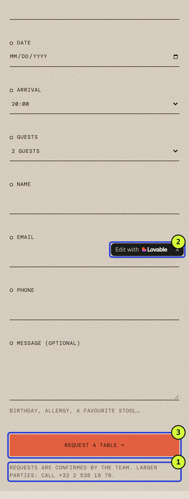

In 2027, Lovable ships a working application, complete with a database, login and admin area, from a single request. We pushed it on a real case: turning a bar’s landing page into a booking app. The security holds, the code is clean, the page is fast. But the app invents a phone number, notifies nobody when a table is booked, and follows no strategy for bringing in customers.

Our view fits in one sentence: Lovable is a very good tool for a first draft or a low-cost site. For a site that brings in customers and grows, you need someone who knows what they are doing.

*Field observations, not a benchmark. Tested in late November 2026 on the free plan, up to date as of 24 November 2026; we will rerun it with every major Lovable release throughout 2027.*

## The test: last article’s landing page, turned into an app

In [our AI, builder or agency comparison](/en/blog/website-ai-builder-or-agency/), Lovable produced the best of three landing pages for Loma, a cocktail bar in Ixelles, Brussels, that we are designing. We went back to that project and asked Lovable to turn it into a real application. In English, the prompt reads:

```prompt
Turn this LOMA landing page into a real application without touching the existing style. Add a database and authentication: public table booking (date, time, party size, name, email, phone, message), newsletter sign-up, and an admin area for Patrick only at /admin to confirm bookings, manage the menu (prices, photos, taste gauges), edit the address, opening hours and thank-you text, and export subscribers as CSV. The landing page now reads the menu, prices, address and opening hours from the database. Only the admin can read bookings and subscribers and edit content. The site must stay fast, accessible and well referenced.
```

The last sentence is deliberately vague: it is what a client would write. Lovable built everything in a few requests, on its built-in database (Lovable Cloud, which runs on Supabase), and synced the code to a GitHub repository.

We then audited the published result: the repository code, the database attacked from outside as a stranger would, accessibility with axe-core 4.14, mobile rendering, speed and search optimisation.

## Security: clean, which was not a given

This was our first worry. In March 2025, [researcher Matt Palmer showed](https://mattpalmer.io/posts/2025/05/statement-on-CVE-2025-48757/) that 170 of 1,645 Lovable applications he analysed left their database readable by anyone, because their access rules were wrong. The flaw received an official identifier, [CVE-2025-48757](https://www.cve.org/CVERecord?id=CVE-2025-48757). Lovable disputes it, pointing out that each customer remains responsible for protecting their own data.

On our app, the database access rules (Supabase’s “Row Level Security”) are in place on all six tables. Without an account, and with only the public key visible in the site’s code, we tried to:

| Attempt by an anonymous visitor | Result |
| --- | --- |
| Read bookings, newsletter subscribers, roles | Refused (empty list) |
| Edit the menu or the bar’s details | Refused (no row changed) |
| Delete every booking | Refused |
| Create a booking that is already “confirmed” | Rejected by the database |
| Grant themselves the admin role | Rejected by the database |
| Upload a file to the photo storage | Refused |

The rest follows suit: the secret key appears neither in the repository nor on the site, sign-up requires email confirmation, and the admin role comes from a list of addresses nobody can read from outside. Lovable even took care of details people often forget when coding by hand: the CSV export neutralises Excel formulas, the form includes a bot trap, and the admin area is kept out of Google.

For visitors, the booking form is well made. Submitted empty, it shows a clear error under each field and moves the cursor to the first one to fix; you cannot pick a past date. axe-core finds no errors on it. The home page renders in under a second.

On the technical side, Lovable did its job. What is missing lies elsewhere.

## What it invents, and why that is worse in a database

The prompt gave no address, no opening hours and no phone number. Lovable invented them in the landing page already, as we noted at the time. Now that it is an application, that information has moved from text into the database: it is handled as real data, shown everywhere and passed on to Google.


The most serious case sits under the booking form: “Larger parties: call +32 2 538 19 78”. Nobody provided this Brussels number. It may belong to someone else, who would get the bar’s customers on the line.



The same number is written into the structured data Lovable added on its own initiative for local search. A good idea, but Google reads that data to fill in its listings:

```json
"@type": "BarOrPub",
"name": "LOMA",
"address": { "streetAddress": "Rue du Bailli 78", "addressLocality": "Ixelles" },
"telephone": "+32 2 538 19 78",
"acceptsReservations": true
```

Wrong information on a page gets noticed eventually. The same information in the code, repeated on every page and sent to search engines, can stay there for months.

## What is missing before opening the app to the public

None of the following is a security hole. These are the things a team sorts out before launch, and that nobody asked for in the prompt:

- **Nobody is notified.** A booking lands in the database, but no email goes to the bar. Patrick has to open the admin area to find out a table is waiting, and the customer gets no confirmation.
- **Nothing stops spam.** No rate limit, no captcha: the bot trap only protects the form, while the database accepts anonymous bookings directly. A script could fill the diary with fake tables.
- **GDPR is missing.** No privacy policy, no consent or unsubscribe link for the newsletter, even though the app collects names, emails and phone numbers.
- **Anyone can create an account.** With no rights at all, but sign-up stays open: it will need closing once Patrick’s account exists.
- **The home page keeps its accessibility issues.** Ten errors on desktop, twelve on mobile: low-contrast text and targets that are too small, the same ones as when the landing page was generated.
- **Search details.** No sitemap, and the login page, written in French, declares itself as English.

Each of these takes a few hours to fix. The problem is knowing they exist: an app that looks finished does not show them.

## The real ceiling: no strategy

The code works. What Lovable does not do is decide what the site is for.

> Writing code that works is good. But there is no strategy behind it: the UX/UI copies an existing art direction to look decent, the SEO targets no relevant keyword, and there is no real information. It is a good prototype, but you can push it much further to turn it into a site that brings in customers. Even when AI makes its strategy look right, it is the same strategy it will hand a competitor with the same idea. You have to be smarter than that.
> — Nicolas Prémont, developer at Horde

The app shows this clearly. The design looks right because it comes from an [art direction](/en/blog/art-direction-for-web-interfaces/) we had already set; Lovable followed it, it did not invent it. The site is entirely in English, for a Brussels bar whose customers search in French and Dutch. It fits on a single page, with no content for “cocktail bar Ixelles” or “private bar hire Brussels”. Nothing measures bookings, nothing follows up with subscribers.

This is the most important point for 2027. A generator produces the most likely answer to a request. If your competitor describes the same idea, they get roughly the same site, with the same structure and the same arguments. What sets you apart is what the tool does not know: your customers, your real information, what people near you are searching for.

## Lovable: what for, and how far

| Your need | Is Lovable enough? |
| --- | --- |
| Testing an idea, showing a working mock-up | Yes, that is its best use |
| A small, low-cost site with your real information checked | Yes, if someone reviews the content and GDPR |
| An app open to the public, holding customer data | As a base, then a rework: notifications, spam, GDPR, accessibility |
| A site that has to bring in customers and grow | Not on its own: you need a strategy, content and follow-up |

Lovable’s subscription prices are covered in [our article on website costs in 2027](/en/blog/website-cost/). And if you are weighing up assistants for the code itself, our [comparison of AI coding tools](/en/blog/best-ai-for-coding/) complements this one.

## What will matter in 2027

We do not know how Lovable will evolve. Here is what we will check with every new release, by running this same test again:

- **Invented information.** Will the tool ask for the address, phone number and prices before writing them, or flag them as placeholders?
- **What surrounds the code.** Notifications, anti-spam limits, GDPR notices: will they appear without being requested?
- **Security by default.** Access rules were correct on our app. Will they stay correct in more complex cases, with data shared between users?
- **Strategy.** Will a generator manage to offer something other than the average answer, based on real data about your market?

## Before you publish a Lovable app

1. Replace every invented detail: address, phone number, opening hours, prices, names. Check the structured data too.
2. Test security from outside, without an account: a stranger must not be able to read or change anything.
3. Add notifications, an anti-spam limit and GDPR notices.
4. Run the page through an accessibility checker and go through it on a phone, as in [our audit method](/en/blog/website-ui-ux-audit/).
5. Decide on the strategy: who is looking for you, with which words, and what the site should get them to do.

**Lovable delivers a good prototype. The site that brings in customers starts where the prompt ends.** If you have a Lovable app to take to production, we rework it as part of our [MVP development](/en/services/mvp-development-brussels/) offer, keeping what works. And to find out first what needs to change, ask for our [free audit](/en/services/ux-ui-audit-brussels/).

## Sources

- App tested: [loma-brussels-cocktail-club.lovable.app](https://loma-brussels-cocktail-club.lovable.app/), generated by Nicolas Prémont with Lovable (free plan, Lovable Cloud), code synced to a private GitHub repository. Viewed 23 to 24 November 2026.
- Database tests run from outside with the public key only, against the project’s Supabase REST API and storage; no data was created or changed. Walkthroughs in Chromium 158 at 1440 × 900 and 390 × 844 pixels, accessibility checks with [axe-core 4.14](https://github.com/dequelabs/axe-core), WCAG 2.2 level A and AA rules.
- [CVE-2025-48757](https://www.cve.org/CVERecord?id=CVE-2025-48757), CVE registry: insufficient access rules in Lovable-generated apps up to 15 April 2025, disputed by the vendor.
- [Matt Palmer, “Statement on CVE-2025-48757”](https://mattpalmer.io/posts/2025/05/statement-on-CVE-2025-48757/), 29 May 2025: 1,645 Lovable projects analysed, 170 with insufficient access rules.
- [Supabase, Row Level Security](https://supabase.com/docs/guides/database/postgres/row-level-security): documentation of the database access rules.
