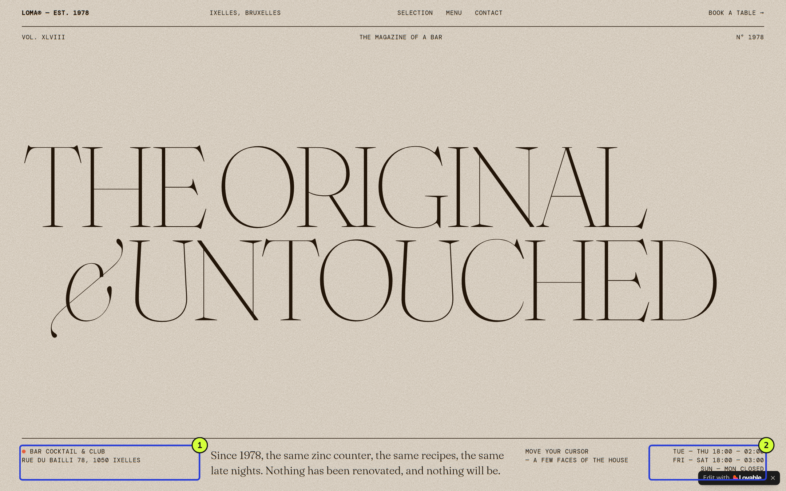
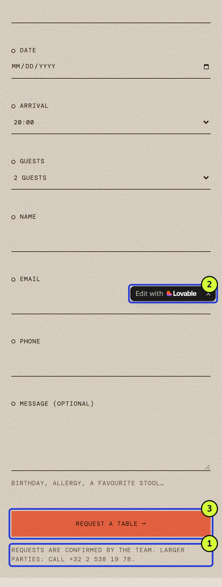

En 2027, Lovable sort une application qui fonctionne, avec base de données, connexion et espace admin, en une seule demande. Nous l’avons poussé sur un vrai cas : transformer la landing d’un bar en application de réservation. La sécurité tient, le code est propre, la page est rapide. Mais l’app invente un numéro de téléphone, ne prévient personne quand une table est réservée, et ne suit aucune stratégie pour faire venir des clients.

Notre avis tient en une phrase : Lovable est un très bon outil pour un premier jet ou un site pas cher. Pour qu’un site rapporte des clients et grandisse, il faut quelqu’un qui sait ce qu’il fait.

*Constats terrain, pas un benchmark. Test réalisé fin novembre 2026 sur l’offre gratuite, à jour au 24 novembre 2026 ; nous le referons à chaque version majeure de Lovable, tout au long de 2027.*

## Le test : la landing de l’article précédent, devenue une app

Dans [notre comparatif IA, builder ou agence](/fr/blog/creer-site-ia-builder-ou-agence/), Lovable avait produit la meilleure des trois landings pour Loma, un bar à cocktails d’Ixelles que nous concevons. Nous sommes repartis de ce projet et lui avons demandé d’en faire une vraie application :

```prompt
Transforme cette landing LOMA en vraie application, sans toucher au style existant. Ajoute une base de données et une authentification : réservation de table publique (date, heure, nombre de personnes, nom, email, téléphone, message), inscription à la newsletter, et un espace admin réservé à Patrick à l’adresse /admin pour confirmer les réservations, gérer la carte (prix, photos, jauges de goût), modifier l’adresse, les horaires et le texte de remerciement, et exporter les inscrits en CSV. La landing lit désormais la carte, les prix, l’adresse et les horaires depuis la base. Seul l’admin peut lire les réservations et les inscrits et modifier les contenus. Le site doit rester rapide, accessible et bien référencé.
```

La dernière phrase est volontairement vague : c’est ce qu’écrirait un client. Lovable a tout construit en quelques demandes, sur sa base de données intégrée (Lovable Cloud, bâtie sur Supabase), et synchronisé le code dans un dépôt GitHub.

Nous avons ensuite audité le résultat publié : le code du dépôt, la base de données attaquée de l’extérieur comme le ferait un inconnu, l’accessibilité avec axe-core 4.14, le rendu mobile, la vitesse et le référencement.

## La sécurité : propre, et ce n’était pas gagné

C’était notre première inquiétude. En mars 2025, [le chercheur Matt Palmer a montré](https://mattpalmer.io/posts/2025/05/statement-on-CVE-2025-48757/) que 170 applications Lovable sur 1 645 analysées laissaient leur base de données lisible par n’importe qui, faute de règles d’accès correctes. La faille a reçu un identifiant officiel, [CVE-2025-48757](https://www.cve.org/CVERecord?id=CVE-2025-48757). Lovable la conteste, en rappelant que chaque client reste responsable de la protection de ses données.

Sur notre app, les règles d’accès de la base (le « Row Level Security » de Supabase) sont en place sur les six tables. Nous avons tenté, sans compte et avec la seule clé publique visible dans le code du site :

| Tentative d’un visiteur anonyme | Résultat |
| --- | --- |
| Lire les réservations, les inscrits à la newsletter, les rôles | Refusé (liste vide) |
| Modifier la carte ou les infos du bar | Refusé (aucune ligne modifiée) |
| Supprimer toutes les réservations | Refusé |
| Créer une réservation déjà « confirmée » | Refusé par la base |
| Se donner le rôle admin | Refusé par la base |
| Déposer un fichier dans le stockage des photos | Refusé |

Le reste suit : la clé secrète n’apparaît ni dans le dépôt ni dans le site, l’inscription exige de confirmer son email, et le rôle admin vient d’une liste d’adresses que personne ne peut lire de l’extérieur. Lovable a même pensé à des détails qu’on oublie souvent à la main : l’export CSV neutralise les formules Excel, le formulaire contient un piège à robots, et l’admin est exclu de Google.

Côté visiteur, le formulaire de réservation est bien fait. Envoyé vide, il affiche une erreur claire sous chaque champ et replace le curseur sur le premier à corriger ; on ne peut pas choisir une date passée. axe-core n’y relève aucune erreur. La page d’accueil s’affiche en moins d’une seconde.

Sur la technique, Lovable a donc fait son travail. Ce qui manque est ailleurs.

## Ce qu’il invente, et pourquoi c’est pire en base de données

Le prompt ne donnait ni adresse, ni horaires, ni numéro de téléphone. Lovable les a inventés dès la landing, nous l’avions relevé. En devenant une application, ces informations sont passées du texte à la base de données : elles sont maintenant gérées comme de vraies données, affichées partout et transmises à Google.



Le cas le plus sérieux est sous le formulaire de réservation : « Larger parties: call +32 2 538 19 78 ». Ce numéro bruxellois n’a été donné par personne. Il peut appartenir à quelqu’un d’autre, qui recevrait les appels des clients du bar.



Le même numéro est inscrit dans les données structurées que Lovable a ajoutées de lui-même pour le référencement local. C’est une bonne initiative, mais Google lit ces données pour remplir ses fiches :

```json
"@type": "BarOrPub",
"name": "LOMA",
"address": { "streetAddress": "Rue du Bailli 78", "addressLocality": "Ixelles" },
"telephone": "+32 2 538 19 78",
"acceptsReservations": true
```

Une information fausse visible sur une page, on finit par la voir. La même information dans le code, répétée sur chaque page et envoyée aux moteurs de recherche, peut rester des mois.

## Ce qui manque avant d’ouvrir l’app au public

Rien de ce qui suit n’est une faille. Ce sont les choses qu’une équipe règle avant la mise en ligne, et que personne n’a demandées dans le prompt :

- **Personne n’est prévenu.** Une réservation arrive en base, mais aucun email ne part vers le bar. Patrick doit ouvrir l’admin pour savoir qu’une table l’attend, et le client ne reçoit aucune confirmation.
- **Rien n’arrête le spam.** Aucune limite d’envois ni captcha : le piège à robots ne protège que le formulaire, alors que la base accepte directement les réservations anonymes. Un script peut remplir l’agenda de fausses tables.
- **Le RGPD est absent.** Pas de politique de confidentialité, pas de consentement ni de lien de désinscription pour la newsletter, alors que l’app collecte nom, email et téléphone.
- **N’importe qui peut créer un compte.** Sans aucun droit, mais l’inscription reste ouverte : il faudra la fermer une fois le compte de Patrick créé.
- **L’accueil garde ses défauts d’accessibilité.** Dix erreurs sur ordinateur, douze sur mobile : des textes trop peu contrastés et des cibles trop petites, les mêmes qu’à la génération de la landing.
- **Les détails du référencement.** Pas de plan du site (sitemap), et la page de connexion, écrite en français, se déclare en anglais.

Chacun de ces points se corrige en quelques heures. Le problème est qu’il faut savoir qu’ils existent : une app qui a l’air finie ne les montre pas.

## Le vrai plafond : aucune stratégie

Le code fonctionne. Ce que Lovable ne fait pas, c’est décider à quoi sert le site.

> Faire du code qui fonctionne, c’est bien. Mais il n’y a aucune stratégie derrière : l’UX/UI reprend une direction artistique existante pour être correcte, le SEO ne vise aucun mot-clé pertinent, et il n’y a aucune vraie information. C’est un bon prototype, mais on peut le pousser beaucoup plus loin pour en faire un site qui ramène de la clientèle. Même quand l’IA donne l’impression que sa stratégie est bonne, c’est la même qu’elle donnera à un concurrent qui a la même idée. Il faut être plus malin que ça.
> — Nicolas Prémont, développeur chez Horde

L’app le montre bien. Le design est correct parce qu’il vient d’une [direction artistique](/fr/blog/direction-artistique-interface-web/) que nous avions déjà fixée ; Lovable l’a suivie, il ne l’a pas inventée. Le site est entièrement en anglais, pour un bar bruxellois dont les clients cherchent en français et en néerlandais. Il tient sur une page, sans contenu pour « bar à cocktails Ixelles » ou « privatiser un bar à Bruxelles ». Rien ne mesure les réservations, rien ne relance les inscrits.

C’est le point le plus important pour 2027. Un générateur produit la réponse la plus probable à une demande. Si votre concurrent formule la même idée, il obtient à peu près le même site, avec la même structure et les mêmes arguments. Ce qui vous distingue, c’est ce que l’outil ne sait pas : votre clientèle, vos vraies informations, ce que cherchent les gens autour de chez vous.

## Lovable : pour quoi, et jusqu’où

| Votre besoin | Lovable suffit ? |
| --- | --- |
| Tester une idée, montrer une maquette qui fonctionne | Oui, c’est son meilleur usage |
| Un petit site pas cher, avec vos vraies informations relues | Oui, si quelqu’un vérifie le contenu et le RGPD |
| Une app ouverte au public, avec des données de clients | Comme base, puis une reprise : notifications, spam, RGPD, accessibilité |
| Un site qui doit faire venir des clients et grandir | Non seul : il faut une stratégie, du contenu et un suivi |

Le prix des abonnements Lovable est détaillé dans [notre article sur le coût d’un site en 2027](/fr/blog/prix-site-internet/). Et si vous hésitez entre plusieurs assistants pour le code lui-même, notre [comparatif des IA pour coder](/fr/blog/meilleure-ia-pour-coder/) complète celui-ci.

## Ce qui va compter en 2027

Nous ne savons pas comment Lovable va évoluer. Voici ce que nous vérifierons à chaque nouvelle version, en relançant ce même test :

- **Les informations inventées.** L’outil demandera-t-il l’adresse, le téléphone et les prix avant de les écrire, ou les signalera-t-il comme provisoires ?
- **Ce qui entoure le code.** Notifications, limites anti-spam, mentions RGPD : apparaîtront-elles sans qu’on les demande ?
- **La sécurité par défaut.** Les règles d’accès étaient correctes sur notre app. Le resteront-elles sur des cas plus complexes, avec des données partagées entre utilisateurs ?
- **La stratégie.** Un générateur saura-t-il proposer autre chose que la réponse moyenne, à partir de données réelles sur votre marché ?

## Avant de publier une app Lovable

1. Remplacez chaque information inventée : adresse, téléphone, horaires, prix, noms. Vérifiez aussi les données structurées.
2. Testez la sécurité de l’extérieur, sans compte : un inconnu ne doit rien lire ni modifier.
3. Ajoutez les notifications, une limite anti-spam et les mentions RGPD.
4. Passez la page dans un outil d’accessibilité et parcourez-la sur téléphone, comme dans [notre méthode d’audit](/fr/blog/audit-ux-ui-site-web/).
5. Décidez de la stratégie : qui vous cherche, avec quels mots, et ce que le site doit leur faire faire.

**Lovable livre un bon prototype. Le site qui fait venir des clients commence là où le prompt s’arrête.** Si vous avez une app Lovable à mettre en production, nous la reprenons dans le cadre de notre offre [développement de MVP](/fr/services/developpement-mvp-bruxelles/), en gardant ce qui fonctionne. Et pour savoir d’abord ce qui doit changer, demandez notre [audit offert](/fr/services/audit-seo-technique-bruxelles/).

## Sources

- Application testée : [loma-brussels-cocktail-club.lovable.app](https://loma-brussels-cocktail-club.lovable.app/), générée par Nicolas Prémont avec Lovable (offre gratuite, Lovable Cloud), code synchronisé sur un dépôt GitHub privé. Consultée du 23 au 24 novembre 2026.
- Tests de la base faits de l’extérieur avec la seule clé publique, sur l’API REST et le stockage Supabase du projet ; aucune donnée créée ni modifiée. Parcours dans Chromium 158 à 1440 × 900 et 390 × 844 pixels, contrôles d’accessibilité avec [axe-core 4.14](https://github.com/dequelabs/axe-core), règles WCAG 2.2 niveaux A et AA.
- [CVE-2025-48757](https://www.cve.org/CVERecord?id=CVE-2025-48757), registre CVE : règles d’accès insuffisantes dans les applications générées par Lovable jusqu’au 15 avril 2025, contesté par l’éditeur.
- [Matt Palmer, « Statement on CVE-2025-48757 »](https://mattpalmer.io/posts/2025/05/statement-on-CVE-2025-48757/), 29 mai 2025 : analyse de 1 645 projets Lovable, 170 avec des règles d’accès insuffisantes.
- [Supabase, Row Level Security](https://supabase.com/docs/guides/database/postgres/row-level-security) : documentation des règles d’accès de la base.
