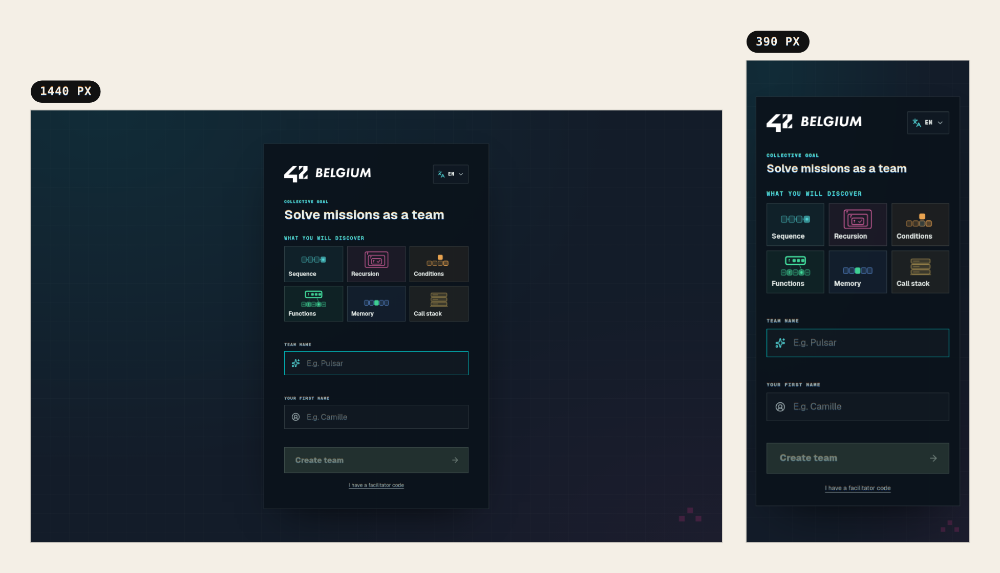
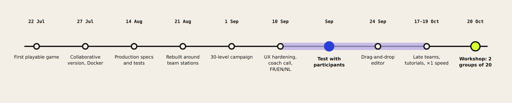
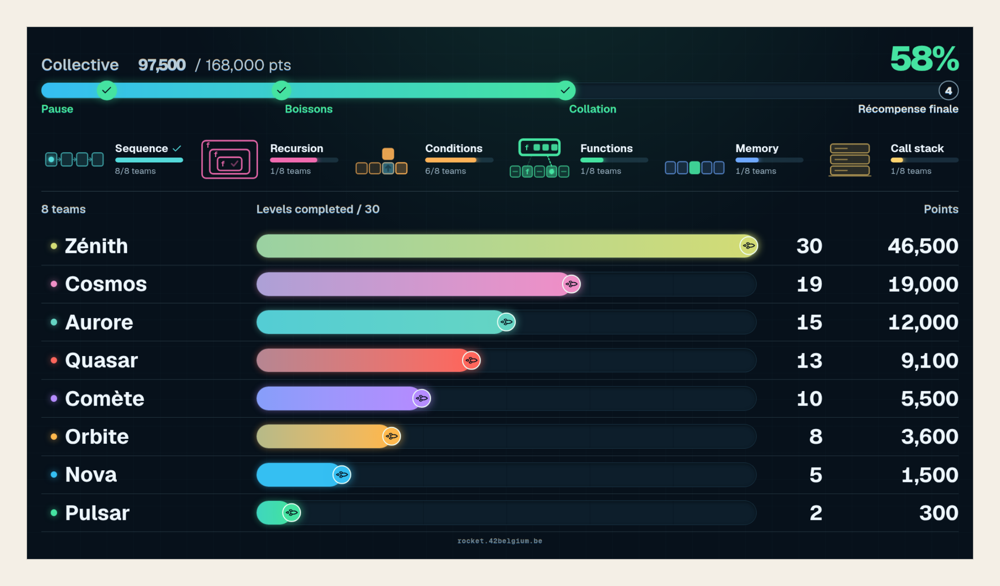

In 2027, vibe coding can take you all the way to production without writing a line of code yourself. We did it this summer: a workshop app built entirely through prompts, without opening a code editor once, ran on 20 October 2026 for two groups of twenty people at 42 Belgium. It held up.

What made it hold up was not the code. AI now writes code that is good enough, especially on the interface side. What made the difference was what we asked for, what we checked, and above all a test with real participants a month before the event.

*Field observations, not a benchmark. Project built from July to October 2026, article up to date as of 25 November 2026; we will add to it with every similar project in 2027.*

## What is vibe coding?

The term comes from AI researcher Andrej Karpathy, who coined it [in February 2025](https://x.com/karpathy/status/1886192184808149383): describe what you want to an AI, accept what it produces, and “forget that the code even exists”. You no longer program, you direct.

Since then, the word has covered two very different practices:

- **Demo vibe coding.** You describe an idea, the tool generates an app, you publish it. That is what Lovable, Bolt or v0 do. The result looks finished. In [our Lovable review](/en/blog/lovable-review/) we showed what it hides: invented information and no strategy.
- **Directed vibe coding.** You still do not touch the code, but you write specifications, require tests, review the results and ship to production yourself. That is what we did on this project.

The difference is not the tool. It is the person directing it.

## The project: a workshop app, without opening the editor

Rocket Mission is an introductory coding workshop created for 42 Belgium. Teams solve logic missions together: they program a rocket that has to collect crystals. The app has four interfaces that talk to each other in real time:

- the **team station**, on a computer, where the team officially validates its solutions;
- the **mobile lab**, on each phone, joined by scanning a QR code, for trying things out without affecting the score;
- the **TV screen**, showing the collective goal and every team’s progress;
- the **control room**, where the facilitator and coaches follow the teams and answer help requests.

All of it was written by AI: with Codex and GPT-5.6 from July to September, then with Claude Code and Claude Opus 5.5 for the final adjustments in October. Nicolas, a developer at Horde, never opened a code editor. He described, reviewed, tested and deployed it himself on his own server.

## What AI did well

The first playable game existed after a single day, on 22 July. Five days later, the collaborative version was running in a Docker container. At delivery, the repository held 39 recorded versions, a Next.js application on a PostgreSQL database, three languages (French, English, Dutch) and more than 400 automated tests.

That is what is genuinely new. Changing a flow, redoing a screen or adding a language no longer costs days: a precise request, a review, a deployment. You can iterate on the interface as often as needed, at a speed that did not exist two years ago.

Our audit of the live version confirms the foundation is sound. axe-core 4.14, the accessibility checker from [our audit method](/en/blog/website-ui-ux-audit/), finds no errors on the station, the lab, the control room or the login, on desktop or mobile. The private interfaces reject any request without credentials, login attempts are rate-limited and passwords are compared safely.

## What made the app hold up: not the code

If code is no longer the problem, what separates this app from a demo generated in ten minutes? Three things, all visible in the repository.

### Specifications before code

In mid-August, before going any further, the project adopted [Spec Kit](https://github.com/github/spec-kit), a method that makes you write down what the app must do before having it written. Eight specification folders followed: production foundations, mobile lab, team progression, game engine, translations, TV screen, 42 Belgium branding. Each describes the need, the edge cases and how to check the result.

AI codes fast, but it codes what you describe. A vague specification gives a vague app, however clean the code.

### Checks on every delivery

Every change went through automated tests, journeys in a real browser from 320 to 1920 pixels wide, and a database backup before each production release, with a version to roll back to. These tests caught real defects. Just before the test with participants, loading a proposal sent from a phone seemed to work, but the program on screen did not change: a piece of information was missing from the server’s response. The defect was reproduced in a test, fixed, then checked on the live version.

Nobody read this code line by line. Everyone checked that it did what it was supposed to do.

### A test with real participants

This is the decisive point. The workshop was run a first time in September, with real participants, a month before the event.

Nothing replaces that moment. You find out what is clear and what is not, what people actually do rather than what you imagined they would do. Around that test and up to the event, the history shows a series of fixes that no prompt would have asked for on its own:

- help instructions switched to a single column on small phones, because they overflowed by more than 200 pixels;
- colour conditions renamed unambiguously (“Always”, “If blue”), with visual feedback during execution;
- an editor where you move instructions with your finger;
- the option to create a team after launch, for latecomers;
- the starting speed brought back to ×1 and shorter tutorials that can be reopened at any time.

On the day, every edge case we had planned for happened at least once: a station to recover mid-session, a team calling a coach, a pause. Each had its own flow. That is why the workshop went well.

## The blind spot: believing your interface is good enough

This is the real risk of vibe coding in 2027. It no longer lies in the code, but in the eye of whoever directs the tool.

In the hands of someone who knows UX, AI makes a first-rate interface possible, because every detail can be fixed the moment you see it. In the hands of someone without that training, it produces an interface that looks fine. And because it looks fine, they stop there. They do not see the text overflowing on a small phone, the button nobody finds, the step nobody understands.

An app with flawless UX goes unnoticed: people do what they came to do without thinking about it. It is the opposite that shows, and sticks out. The only reliable way to know which case you are in is to watch real users use it. Nielsen Norman Group research has long shown that [a handful of testers](https://www.nngroup.com/articles/why-you-only-need-to-test-with-5-users/) is enough to surface most of the problems.

> Today I hardly write any code. I review, I check, I maintain and I ship to production myself. Learning a language or dwelling on how the code is written, when everything works end to end, means putting your attention in the wrong place. What matters in a good interface is how users get on with it, and whether it is secure. The rest is nitpicking.
> — Nicolas Prémont, developer at Horde

## What we would still rework

Our audit finds a few points that no participant noticed, but that a team would fix before reusing the app:

- **The server’s security headers** are missing (protection against being shown inside another page, content policy, forced HTTPS). They are set in the server configuration, not in the app code.
- **The TV screen** carries ten misplaced accessibility attributes on its gauges. Harmless on a screen nobody operates, but worth fixing.
- **The home screen** has no marked-up main heading. For a workshop app that is not meant to be found on Google, that is a detail; on a public site it would be a real gap.

These are finishing touches, not security holes. They show the same thing as everything else: the generated code was good, and human checking is still needed.

## Vibe coding: when it is enough, when you need a team

| Your situation | What you need |
| --- | --- |
| Testing an idea, showing a working mock-up | A generation tool on its own, such as Lovable or Bolt |
| An internal app for a few people, with no sensitive data | Vibe coding, plus a security review |
| An app used live by the public, such as an event | Specifications, tests and at least one test with real users |
| A product that has to last, sell and evolve | A team that directs the AI: UX, security, deployment, follow-up |

The choice of assistant matters less than people think. If you are unsure, our [comparison of AI coding tools](/en/blog/best-ai-for-coding/) covers the strengths of each. And to see how this kind of app serves an event, we tell the workshop side of the story in [our article on event web apps](/en/blog/ai-assisted-event-web-apps/).

## What will change in 2027

We do not know how fast models will improve, or at what price. Here is what we will watch on our next projects:

- **The share of hand-written code.** It was zero on this project. Will it stay that way on longer products, with several people involved?
- **Tool limits and speed.** They change from one release to the next and can slow a project down overnight. We already switched assistants mid-project.
- **The role of specifications.** Will the tools learn to ask for edge cases themselves, instead of waiting for someone to describe them?
- **User testing.** It is the one step AI does not shorten. We will see whether assisted testing tools change that, without replacing real participants.

## Where to start

1. Describe the need and the edge cases before the first prompt: who uses the app, in what conditions, and what can go wrong.
2. Require tests and check that they pass, without necessarily reading the code.
3. Check security from outside: without credentials, a stranger must not be able to read or change anything.
4. Have real people test the app, in real conditions, early enough to fix things.
5. Keep a backup and a rollback version for every production release.

**In 2027, AI writes good-enough code. A good app is tuned by watching its users.** If you have a vibe-coded app to take to production, we rework it as part of our [MVP development](/en/services/mvp-development-brussels/) offer. For a workshop or event, see our [event web apps](/en/services/event-web-apps/). And to find out first what needs to change, ask for our [free audit](/en/services/ux-ui-audit-brussels/).

## Sources

- App studied: Rocket Mission, live at [rocket.42belgium.be](https://rocket.42belgium.be/), workshop on 20 October 2026 for 42 Belgium (two groups of twenty participants). Private GitHub repository: history from July to October 2026, specifications and deployment reports reviewed in November 2026.
- Audit of the live version on 25 November 2026: Chromium 158 at 1440 × 900, 390 × 844 and 1920 × 1080 pixels, [axe-core 4.14](https://github.com/dequelabs/axe-core) (WCAG 2.2 level A and AA rules), access to private interfaces tested without credentials. Only read requests were sent; no team or session was created.
- [Andrej Karpathy, post of 2 February 2025](https://x.com/karpathy/status/1886192184808149383), origin of the term “vibe coding”.
- [GitHub Spec Kit](https://github.com/github/spec-kit): specification-driven development method.
- [Nielsen Norman Group, “Why You Only Need to Test with 5 Users”](https://www.nngroup.com/articles/why-you-only-need-to-test-with-5-users/).
