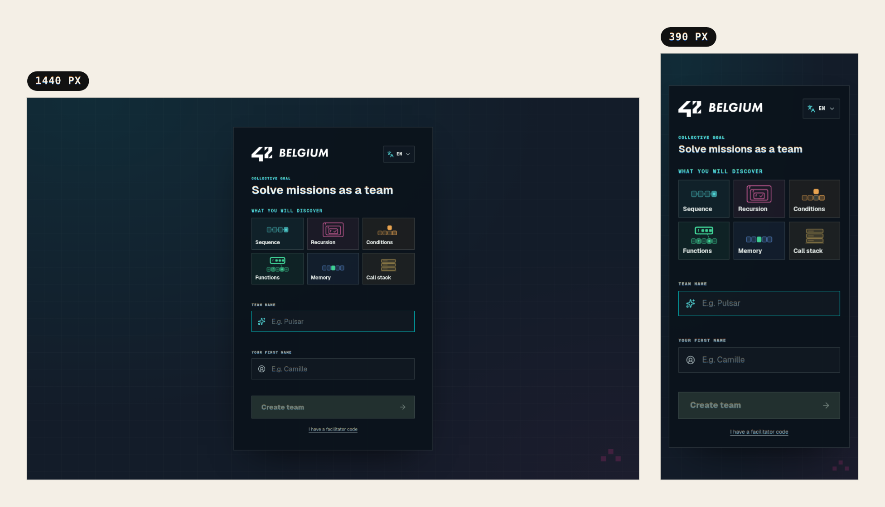
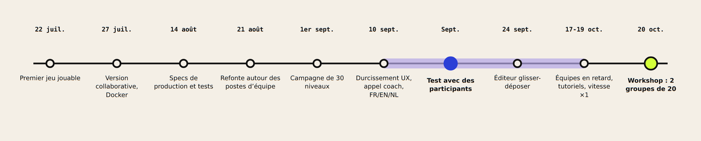
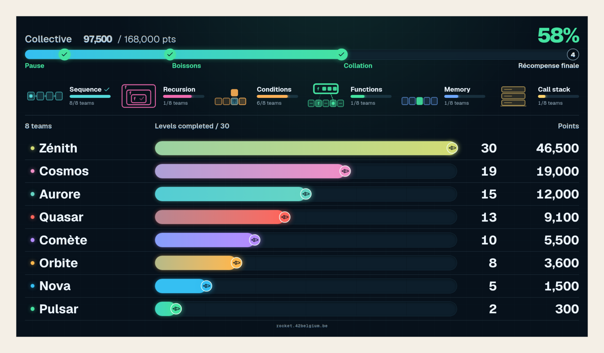

En 2027, le vibe coding permet d’aller jusqu’en production sans écrire soi-même une ligne de code. Nous l’avons fait cet été : une application de workshop construite uniquement par prompts, sans ouvrir l’éditeur de code une seule fois, a servi le 20 octobre 2026 à deux groupes de vingt personnes chez 42 Belgium. Elle a tenu.

Ce qui l’a fait tenir n’est pas le code. L’IA écrit désormais un code suffisant, surtout côté interface. Ce qui a fait la différence, c’est ce qu’on lui a demandé, ce qu’on a vérifié, et surtout un test avec de vrais participants un mois avant l’événement.

*Constats terrain, pas un benchmark. Projet réalisé de juillet à octobre 2026, article à jour au 25 novembre 2026 ; nous le compléterons à chaque nouveau projet de ce type en 2027.*

## Le vibe coding, c’est quoi ?

Le terme vient d’Andrej Karpathy, chercheur en IA, qui l’a lancé [en février 2025](https://x.com/karpathy/status/1886192184808149383) : décrire ce qu’on veut à une IA, accepter ce qu’elle produit, et « oublier que le code existe ». On ne programme plus, on dirige.

Depuis, le mot recouvre deux pratiques très différentes :

- **Le vibe coding de démonstration.** On décrit une idée, l’outil génère une app, on la publie. C’est ce que font Lovable, Bolt ou v0. Le résultat a l’air fini. Nous avons montré dans [notre avis sur Lovable](/fr/blog/lovable-avis/) ce qu’il cache : des informations inventées, aucune stratégie.
- **Le vibe coding piloté.** On ne touche toujours pas au code, mais on écrit des spécifications, on exige des tests, on relit les résultats et on met en production soi-même. C’est ce que nous avons fait pour ce projet.

La différence ne tient pas à l’outil. Elle tient à la personne qui le dirige.

## Le projet : une app de workshop, sans ouvrir l’éditeur

Rocket Mission est un atelier d’initiation à la programmation, créé pour 42 Belgium. Des équipes résolvent ensemble des missions de logique : on programme une fusée qui doit ramasser des cristaux. L’app compte quatre interfaces qui se parlent en temps réel :

- le **poste d’équipe**, sur un ordinateur, où l’équipe valide officiellement ses solutions ;
- le **laboratoire mobile**, sur chaque téléphone, rejoint en scannant un QR code, pour faire des essais sans toucher au score ;
- l’**écran TV**, qui affiche l’objectif collectif et la progression de toutes les équipes ;
- la **régie**, pour le facilitateur et les coachs, qui suivent les équipes et répondent aux demandes d’aide.

Tout a été écrit par l’IA : avec Codex et GPT-5.6 de juillet à septembre, puis avec Claude Code et Claude Opus 5.5 pour les derniers ajustements d’octobre. Nicolas, développeur chez Horde, n’a pas ouvert d’éditeur de code. Il a décrit, relu, testé, et déployé lui-même sur son serveur.

## Ce que l’IA a bien fait

Le premier jeu jouable existait au bout d’une journée, le 22 juillet. Cinq jours plus tard, la version collaborative tournait dans un conteneur Docker. À la livraison, le dépôt comptait 39 versions enregistrées, une application Next.js avec une base PostgreSQL, trois langues (français, anglais, néerlandais) et plus de 400 tests automatisés.

C’est la vraie nouveauté. Changer un parcours, refaire un écran, ajouter une langue ne coûte plus des jours : une demande précise, une relecture, un déploiement. On peut itérer sur l’interface autant de fois qu’il le faut, à une vitesse qui n’existait pas il y a deux ans.

Notre audit de la version en ligne confirme que la base est saine. axe-core 4.14, l’outil d’accessibilité de [notre méthode d’audit](/fr/blog/audit-ux-ui-site-web/), ne relève aucune erreur sur le poste, le laboratoire, la régie et la connexion, sur ordinateur comme sur mobile. Les interfaces privées refusent toute demande sans identifiant, les tentatives de connexion sont limitées et les mots de passe sont comparés de façon sûre.

## Ce qui a fait tenir l’app : pas le code

Si le code n’est plus le problème, qu’est-ce qui sépare cette app d’une démo générée en dix minutes ? Trois choses, toutes visibles dans le dépôt.

### Des spécifications avant le code

À la mi-août, avant d’aller plus loin, le projet a adopté [Spec Kit](https://github.com/github/spec-kit), une méthode qui oblige à écrire ce que l’app doit faire avant de le faire écrire. Huit dossiers de spécifications ont suivi : fondations de production, laboratoire mobile, progression des équipes, moteur de jeu, traductions, écran TV, identité 42 Belgium. Chacun décrit le besoin, les cas limites et la façon de vérifier le résultat.

L’IA code vite, mais elle code ce qu’on lui décrit. Une spécification floue donne une app floue, aussi propre que soit le code.

### Des vérifications à chaque livraison

Chaque changement est passé par des tests automatiques, des parcours dans un vrai navigateur de 320 à 1920 pixels de large, et une sauvegarde de la base avant chaque mise en production, avec une version de retour possible. Ces tests ont attrapé de vrais défauts. Juste avant le test avec des participants, le chargement d’une proposition envoyée depuis un téléphone semblait fonctionner, mais le programme affiché ne changeait pas : une information manquait dans la réponse du serveur. Le défaut a été reproduit dans un test, corrigé, puis vérifié sur la version en ligne.

Personne n’a lu ce code ligne par ligne. Tout le monde a vérifié qu’il faisait ce qu’il devait faire.

### Un test avec de vrais participants

C’est le point décisif. Le workshop a été joué une première fois en septembre, avec de vrais participants, un mois avant l’événement.

Rien ne remplace ce moment. On découvre ce qui est clair et ce qui ne l’est pas, ce que les gens font vraiment, et non ce qu’on imaginait qu’ils feraient. Autour de ce test et jusqu’à l’événement, l’historique montre une série de corrections qu’aucun prompt n’aurait demandées seul :

- les instructions d’aide passées sur une colonne sur petit téléphone, parce qu’elles débordaient de plus de 200 pixels ;
- les conditions de couleur renommées sans ambiguïté (« Toujours », « Si bleu »), avec un retour visuel pendant l’exécution ;
- un éditeur où l’on déplace les instructions au doigt ;
- la possibilité de créer une équipe après le lancement, pour les retardataires ;
- la vitesse de départ ramenée à ×1 et des tutoriels plus courts, rouvrables à tout moment.

Le jour J, tous les cas particuliers prévus sont arrivés au moins une fois : un poste à récupérer en cours de session, une équipe qui appelle un coach, une pause. Chacun avait son parcours. C’est pour ça que l’atelier s’est bien passé.

## L’angle mort : croire que son interface suffit

Voilà le vrai risque du vibe coding en 2027. Il ne se trouve plus dans le code, mais dans le regard de la personne qui dirige l’outil.

Entre les mains de quelqu’un qui connaît l’UX, l’IA permet une interface de pointe, parce qu’on peut corriger chaque détail aussitôt qu’on le voit. Entre les mains de quelqu’un qui n’y est pas formé, elle produit une interface qui a l’air correcte. Et comme elle a l’air correcte, on s’arrête là. On ne voit pas le texte qui déborde sur un petit téléphone, le bouton qu’on ne trouve pas, l’étape que personne ne comprend.

Une app à l’UX impeccable ne se remarque pas : les gens font ce qu’ils sont venus faire, sans y penser. C’est l’inverse qui se voit, et qui fait tache. Le seul moyen fiable de savoir dans quel cas on se trouve, c’est de regarder de vrais utilisateurs s’en servir. Les études du Nielsen Norman Group montrent depuis longtemps que [quelques testeurs suffisent](https://www.nngroup.com/articles/why-you-only-need-to-test-with-5-users/) à faire apparaître l’essentiel des problèmes.

> Aujourd’hui, je n’écris pratiquement plus de code. Je relis, je contrôle, je maintiens et je mets en production moi-même. Apprendre un langage ou s’attarder sur la façon dont le code est écrit, alors que tout fonctionne de bout en bout, c’est mettre son attention au mauvais endroit. Ce qui compte dans une bonne interface, c’est comment l’utilisateur se débrouille avec, et si elle est sécurisée. Le reste, c’est du chipotage.
> — Nicolas Prémont, développeur chez Horde

## Ce qu’on reprendrait encore

Notre audit relève quelques points, qu’aucun participant n’a remarqués mais qu’une équipe corrigerait avant de réutiliser l’app :

- **Les en-têtes de sécurité du serveur** sont absents (protection contre l’affichage dans une autre page, politique de contenu, HTTPS forcé). Ils se règlent dans la configuration, pas dans le code de l’app.
- **L’écran TV** porte dix attributs d’accessibilité mal placés sur ses jauges. Sans effet sur un écran que personne ne pilote, mais à corriger.
- **L’accueil** n’a pas de titre principal balisé. Pour une app d’atelier qui n’a pas vocation à être trouvée sur Google, c’est un détail ; pour un site public, ce serait un vrai manque.

Ce sont des points de finition, pas des failles. Ils montrent la même chose que le reste : le code généré était bon, la vérification humaine reste nécessaire.

## Vibe coding : quand ça suffit, quand il faut une équipe

| Votre situation | Ce qu’il faut |
| --- | --- |
| Tester une idée, montrer une maquette qui fonctionne | Un outil de génération seul, comme Lovable ou Bolt |
| Une app interne pour quelques personnes, sans données sensibles | Le vibe coding, plus une relecture de la sécurité |
| Une app utilisée en direct par du public, comme un événement | Des spécifications, des tests, et au moins un test avec de vrais utilisateurs |
| Un produit qui doit durer, se vendre et évoluer | Une équipe qui pilote l’IA : UX, sécurité, mise en production, suivi |

Le choix de l’assistant compte moins qu’on ne le croit. Si vous hésitez, notre [comparatif des IA pour coder](/fr/blog/meilleure-ia-pour-coder/) détaille les forces de chacun. Et pour voir comment ce type d’app sert un événement, nous racontons le projet côté atelier dans [notre article sur les webapps événementielles](/fr/blog/webapp-evenementielle-ia/).

## Ce qui va changer en 2027

Nous ne savons pas à quelle vitesse les modèles vont progresser, ni à quel prix. Voici ce que nous surveillerons sur nos prochains projets :

- **La part du code écrite à la main.** Elle était nulle sur ce projet. Le restera-t-elle sur des produits plus longs, avec plusieurs personnes ?
- **Les limites et la vitesse des outils.** Elles changent d’une version à l’autre et peuvent ralentir un projet du jour au lendemain. Nous avons déjà changé d’assistant en cours de route.
- **La place des spécifications.** Les outils sauront-ils réclamer eux-mêmes les cas limites, au lieu d’attendre qu’on les décrive ?
- **Le test utilisateur.** C’est la seule étape que l’IA ne raccourcit pas. Nous verrons si des outils de test assisté changent cela, sans remplacer de vrais participants.

## Par où commencer

1. Décrivez le besoin et les cas particuliers avant le premier prompt : qui utilise l’app, dans quelles conditions, et ce qui peut mal tourner.
2. Exigez des tests et vérifiez qu’ils passent, sans forcément lire le code.
3. Contrôlez la sécurité de l’extérieur : sans identifiant, un inconnu ne doit rien lire ni modifier.
4. Faites tester l’app par de vraies personnes, en conditions réelles, assez tôt pour corriger.
5. Gardez une sauvegarde et une version de retour à chaque mise en production.

**En 2027, l’IA écrit un code suffisant. Une bonne app, elle, se règle en regardant ses utilisateurs.** Si vous avez une app vibe-codée à mettre en production, nous la reprenons dans le cadre de notre offre [développement de MVP](/fr/services/developpement-mvp-bruxelles/). Pour un atelier ou un événement, voyez nos [applications événementielles](/fr/services/applications-evenementielles/). Et pour savoir d’abord ce qui doit changer, demandez notre [audit offert](/fr/services/audit-seo-technique-bruxelles/).

## Sources

- Application étudiée : Rocket Mission, en ligne sur [rocket.42belgium.be](https://rocket.42belgium.be/), workshop du 20 octobre 2026 pour 42 Belgium (deux groupes de vingt participants). Dépôt GitHub privé : historique de juillet à octobre 2026, spécifications et comptes rendus de mise en production consultés en novembre 2026.
- Audit de la version en ligne le 25 novembre 2026 : Chromium 158 à 1440 × 900, 390 × 844 et 1920 × 1080 pixels, [axe-core 4.14](https://github.com/dequelabs/axe-core) (règles WCAG 2.2 niveaux A et AA), accès aux interfaces privées testés sans identifiant. Seules des requêtes de lecture ont été envoyées ; aucune équipe ni session n’a été créée.
- [Andrej Karpathy, message du 2 février 2025](https://x.com/karpathy/status/1886192184808149383), origine du terme « vibe coding ».
- [GitHub Spec Kit](https://github.com/github/spec-kit) : méthode de développement guidé par les spécifications.
- [Nielsen Norman Group, « Why You Only Need to Test with 5 Users »](https://www.nngroup.com/articles/why-you-only-need-to-test-with-5-users/).
