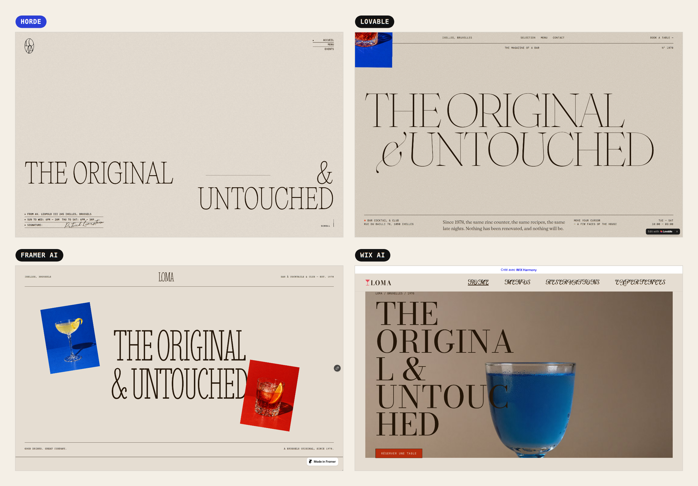
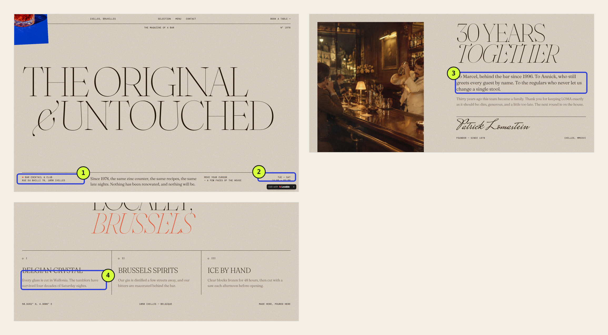
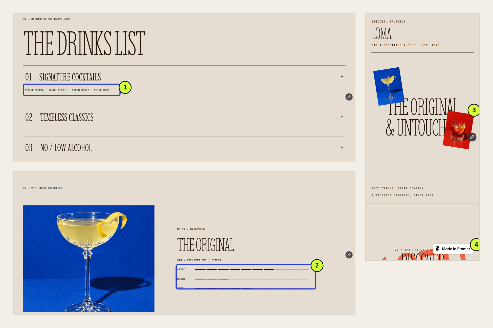
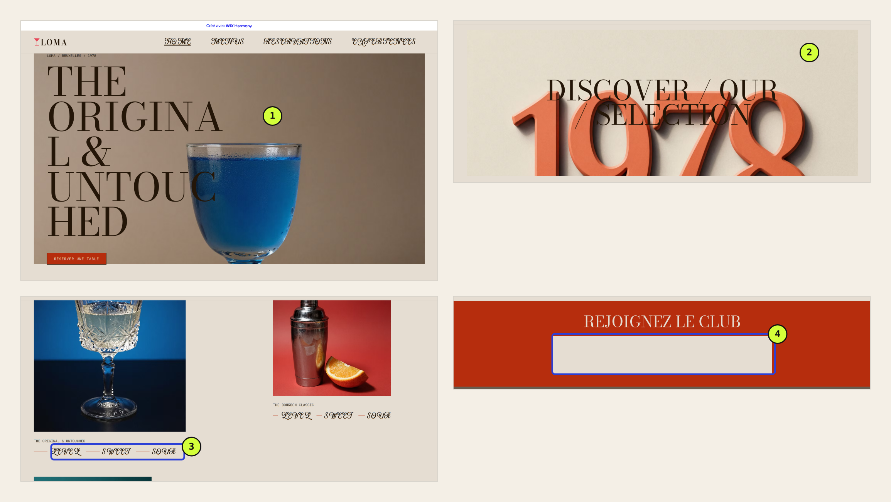
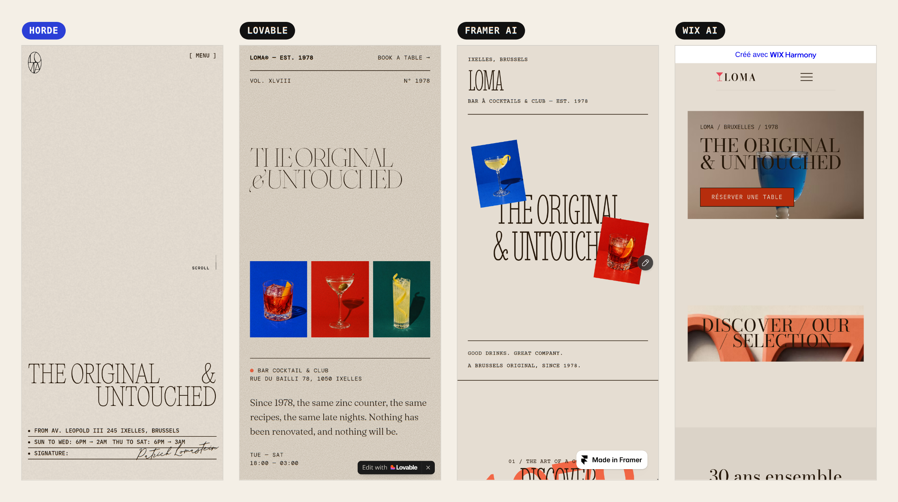

In 2027, an AI generator or website builder delivers a site in a few minutes. What it delivers depends mostly on what you give it, and what is left to do after generation still takes time. To check, we gave the same brief to Lovable, Framer AI and Wix AI. The brief comes from our own design work on a real project.

The result: Lovable produces a solid base but makes up part of the information. Framer copies the style without the content, and Wix manages neither. None of the three could go live as it is. This article shows where each one stops, and when a generator is genuinely enough.

*Field observations, not a benchmark. Tested in November 2026 on the free plans, up to date as of 20 November 2026; we will rerun it with every major release of these tools throughout 2027.*

## The test: a designer’s brief, three generators

The project is the landing page for Loma, a cocktail bar in Ixelles, Brussels, that we are designing right now. We wrote a single prompt, in French, and gave it unchanged to all three tools. In English, it reads:

```prompt
One-page landing page for LOMA, a cocktail bar & club founded in 1978 in Ixelles (Brussels), signed by its founder Patrick Lomastein. Retro-chic editorial magazine style: sand background #E5DDD2, brown-black text #241608, coral orange accent #F26746, film grain. Giant titles in ultra-thin serif (PP Editorial New Thin), condensed capitals, small text in 11 px monospace capitals, handwritten signature. 1 px rules, round bullets, plenty of white space, no shadows or rounded corners. Studio photos of cocktails on flat saturated backgrounds (electric blue, red, teal, burgundy), hard light. Sections: hero "THE ORIGINAL & UNTOUCHED" with photos that follow the cursor, "DISCOVER / OUR / SELECTION" over a giant orange "1978" stamp in parallax, thank-you note "30 years together", origin "Designed locally, Brussels", featured cocktails in an exploded layout with LEVEL/SWEET/SOUR taste sliders, numbered accordion menu, taupe footer "BAR COCKTAIL & CLUB" with newsletter and giant oval monogram.
```

This is not a beginner’s prompt. Colours, typefaces, tone, the list of sections, the interactions: everything comes from the art direction we had already set for Loma. All three tools had every key they needed to succeed. The test is deliberately generous to the generators: it shows them at their best.

We went through all four pages (the three generated ones and ours) in Chromium at 1440 × 900 pixels on desktop and 390 × 844 on mobile, then ran them through axe-core 4.14, the accessibility checker we use in [our UI/UX audit method](/en/blog/website-ui-ux-audit/).



## What each tool produced

### Lovable: a solid base, and made-up information

Lovable comes closest to the brief. The typography is right, the “1978” stamp moves as you scroll, the photos follow the cursor, the menu opens and closes cleanly, and the open state is announced to screen readers. In terms of form, it is a serious starting point.

The problem lies elsewhere: the prompt gave no address, no opening hours and no prices. Lovable invented them.



An address (1), opening hours (2), nine cocktails with prices, staff members such as Marcel, “behind the bar since 1996” (3), glasses “cut in Wallonia” (4), and even a note that “all prices include VAT and service”. Everything is plausible, well written and on brand. None of it comes from the client.

That makes it the most dangerous flaw of the three, precisely because you cannot see it. Published as it is, the site would send customers to the wrong address, at the wrong time, expecting the wrong prices.

The accessibility checker also flags nine errors on desktop: five contrast failures and four targets that are too small. More than 140 pieces of text are set below 12 pixels, partly because the brief asked for 11-pixel small text. Style and legibility will have to be balanced, as with [any art direction](/en/blog/art-direction-for-web-interfaces/).

### Framer: faithful on the surface, empty underneath

On desktop, Framer captures the look of the brief well: the palette, the large condensed titles, the rules, the exploded cocktail layout, the taupe footer with its oval monogram. In a screenshot, it is almost convincing.

The illusion falls apart as soon as you look for information.



The numbered menu is not really a menu: it lists four categories, and the first one opens onto four cocktail names and nothing else (1). There is no price anywhere on the page, no address and no opening hours. The taste gauges are decorative bars with no values (2). The large title is not marked up as the main heading, which matters for search engines and screen readers.

On mobile, a photo covers the end of the title (3), and the “1978” stamp does not move when you scroll. axe-core, for its part, reports no errors at all. That is the limit of automated checks: they test rules, not whether the page is useful.

### Wix: neither the style nor the features

Wix is furthest from the brief, and the problems show from the first screen.



The main title breaks in the middle of words (1). The “1978” stamp is an embossed image with drop shadows (2), the opposite of the brief, and the heading set over it is hard to read. The “30 ans ensemble” section has a title and a signature but no message. The taste gauges have become three words in a script font (3).

The menu section is literally titled “Carte accordéon”, French for “accordion menu”: the name of the requested component became the section heading. Its rows do not open. The newsletter is reduced to a white rectangle (4). The photos do not follow the cursor, and every one of them has an empty alt text. The page fires more than 200 requests on load, against 15 to 46 for the other three versions.

## The brief, line by line

| Requested in the brief | Lovable | Framer AI | Wix AI |
| --- | --- | --- | --- |
| Giant ultra-thin serif titles | Yes | Yes, more condensed | No, broken mid-word |
| No shadows or rounded corners | Yes | Yes | No |
| Photos that follow the cursor | Yes | Yes | No |
| “1978” stamp in parallax | Yes | Static stamp | Static embossed image |
| “30 years together” thank-you note | Yes, with invented names | Yes | Title, no message |
| LEVEL / SWEET / SOUR gauges | Yes, with values | Bars, no values | Script words |
| Numbered accordion menu | Yes, with invented prices | Categories, no prices | Does not open |
| Footer, newsletter, oval monogram | Yes | Yes | Square monogram, empty newsletter |

On mobile, the ranking holds: Lovable stays readable, Framer stacks its photos on the title, and Wix shrinks the first screen to a banner.



## Why Lovable does better

Our reading comes down to two reasons. First, the brief was already doing much of the work: a tool that follows it to the letter gets a lot out of it. Second, Lovable writes code, while Framer and Wix assemble the page from their editor’s building blocks. When the brief asks for a layout those blocks cannot produce, the tool gets close, or swaps in what it knows how to do.

So this is not a definitive ranking of the tools. With a vague brief, the gap would probably have narrowed and all three results would have looked more generic. Above all, the test shows that a generator reproduces the quality of what you give it, and rarely more.

## What generation will not do for you

All three versions were produced in a few minutes. What each one is missing, however, cannot be generated:

- **The brief itself.** The choices of colour, typography, tone and sections that made Lovable succeed came out of our design work. Without them, there is nothing to follow.
- **The real information.** Address, opening hours, prices, menu, team: the tool either invents them (Lovable) or leaves them out (Framer). Both have to be redone by hand, with the client.
- **Checking.** Contrast, touch targets, mobile reading, keyboard navigation, heading structure: someone has to go through the page, as in [our audit method](/en/blog/website-ui-ux-audit/).
- **What comes next.** Who updates the menu when a cocktail changes? Can you take the site with you if you leave the tool? We cover those costs in [our article on website prices in 2027](/en/blog/website-cost/).

Our own version of Loma is still in development, so we are not presenting it as a finished model. Its difference is not primarily visual. Every piece of content in it comes from the client, and every section was decided before a single prompt was written.

## AI, builder or agency: when each one is enough

| Your situation | What is enough |
| --- | --- |
| Testing an idea, or an event page that will live a few weeks | A builder or generator, with your real information checked line by line |
| You already have an art direction and someone to review the result | A code generator such as Lovable, then a review of accessibility and content |
| The site has to sell, represent the brand and evolve for years | A team that designs the brief, then builds and checks the site |
| You already have a generated site that is not working | A rework: keep what works, fix the rest |

Starting with AI is not a mistake. It is fast, and for a first version that is a real advantage. Just know that the generated page is a draft, even when it looks finished. We said as much about [AI coding tools](/en/blog/best-ai-for-coding/): the code has become good enough, the experience has not.

## What will change in 2027

We do not know how fast these tools will improve. Here is what we will check with every new release, by running this same brief again:

- **Fidelity to the brief.** Will block-based builders such as Framer and Wix learn to step outside their components when a brief calls for it?
- **Invented information.** Will generators flag what they made up, or ask for the address and prices before writing them?
- **Accessibility.** Since June 2025, the [European Accessibility Act](https://eur-lex.europa.eu/legal-content/EN/TXT/?uri=CELEX%3A32019L0882) has applied to e-commerce. A generated site will have to meet those requirements without a full manual review.
- **Ownership.** Will a Framer or Wix site be as easy to take with you as a Lovable project synced to your own code repository?

## Where to start

1. Write down what the site has to do, then the brief: colours, tone, sections, before any prompt.
2. Generate a first version if you like, with the tool of your choice.
3. Check every factual detail: address, opening hours, prices, names.
4. Go through the page on a phone and with a keyboard, all the way to the end.
5. Decide who will keep it up to date, and with what tool.

**AI delivers the first version. The site is finished when every detail is true and every journey has been checked.** If you started with a generator, our [free audit](/en/services/technical-seo-audit-brussels/) tells you what can stay and what needs reworking. And if you are starting from scratch, we also design [landing pages](/en/services/landing-page-design-brussels/) from brief to launch. For more ideas, read [how to make your website stand out](/en/blog/how-to-make-your-website-stand-out-2026/).

## Sources

- Versions generated from the same prompt, free plans, viewed in November 2026: [Lovable](https://loma-brussels-cocktail-club.lovable.app/), [Framer AI](https://biggest-trust-162472.framer.app/), [Wix AI](https://nico77305.wixsite.com/loma).
- Horde’s version of the Loma landing page: development version, unpublished, content still being approved.
- Walkthroughs in Chromium 158 at 1440 × 900 and 390 × 844 pixels; accessibility checks with [axe-core 4.14](https://github.com/dequelabs/axe-core), WCAG 2.2 level A and AA rules. Menu toggles, cursor tracking and parallax were tested through real interaction.
- [Lovable FAQ](https://docs.lovable.dev/introduction/faq): code generation and project ownership.
- [Directive (EU) 2019/882 on the accessibility requirements for products and services](https://eur-lex.europa.eu/legal-content/EN/TXT/?uri=CELEX%3A32019L0882).
