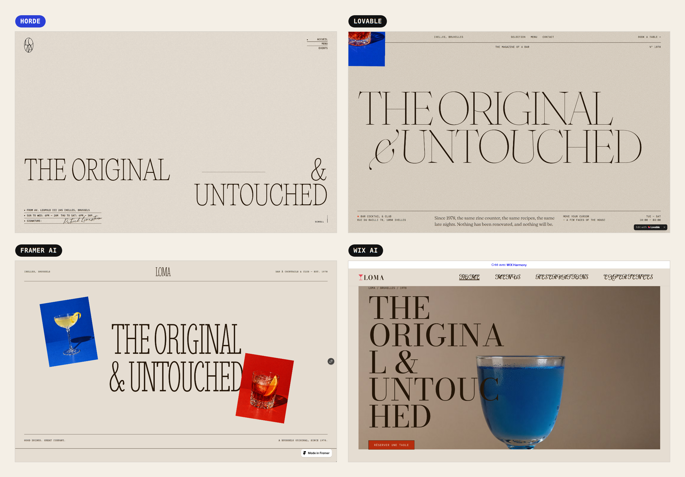
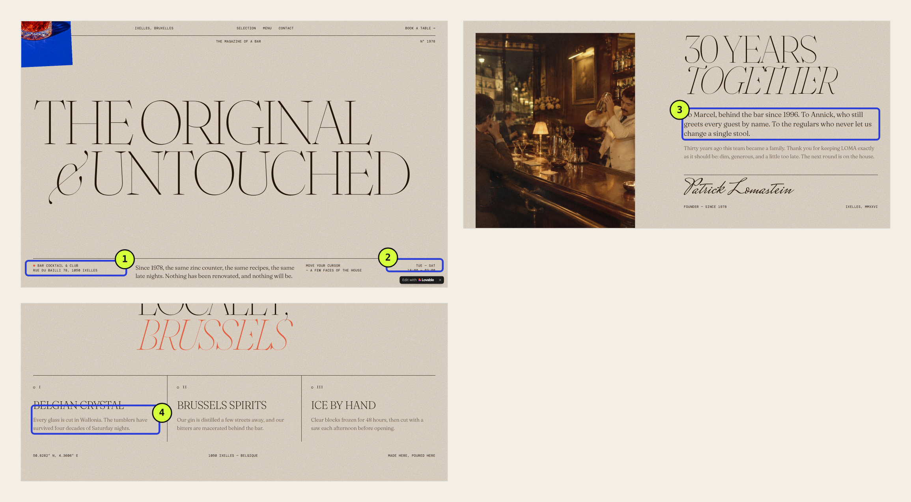
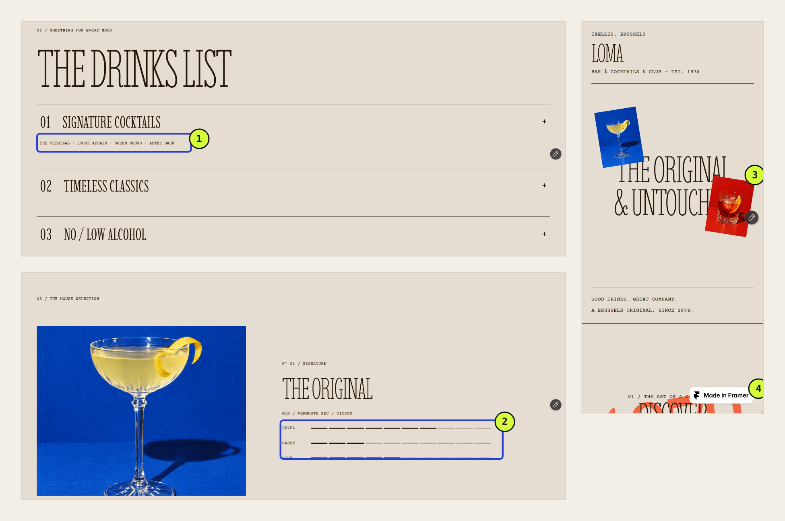
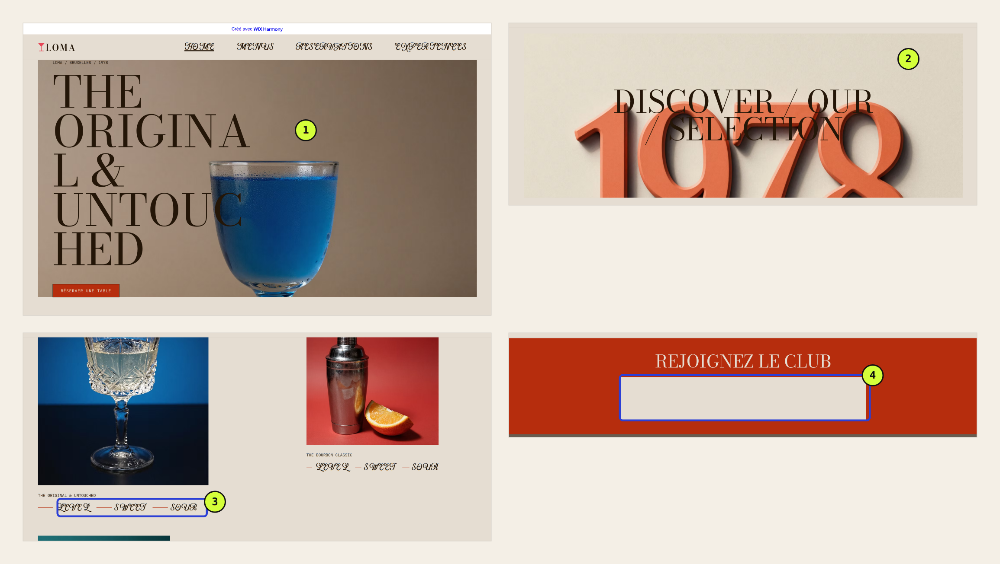
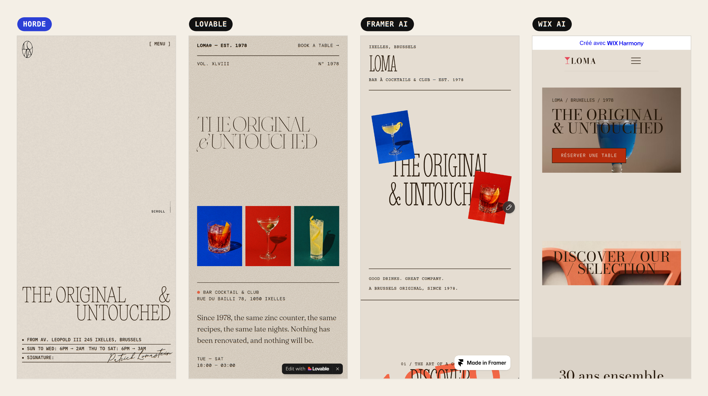

En 2027, un générateur IA ou un builder livre un site en quelques minutes. Ce qu’il livre dépend surtout de ce qu’on lui donne, et ce qui reste à faire après la génération prend toujours du temps. Pour le vérifier, nous avons donné le même brief à Lovable, Framer AI et Wix AI. Ce brief vient de notre propre travail de conception sur un vrai projet.

Résultat : Lovable produit une base correcte, mais invente une partie des informations. Framer reproduit le style sans le contenu, et Wix ne tient ni l’un ni l’autre. Aucun des trois n’est publiable tel quel. Cet article montre où chacun s’arrête, et quand un générateur suffit vraiment.

*Constats terrain, pas un benchmark. Test réalisé en novembre 2026 sur les offres gratuites, à jour au 20 novembre 2026 ; nous le referons à chaque version majeure de ces outils, tout au long de 2027.*

## Le test : un brief de designer, trois générateurs

Le projet est la landing page de Loma, un bar à cocktails d’Ixelles que nous concevons en ce moment. Nous avons écrit un seul prompt et l’avons donné tel quel aux trois outils :

```prompt
Landing page one-page pour LOMA, bar à cocktails & club fondé en 1978 à Ixelles (Bruxelles), signé par son fondateur Patrick Lomastein. Style magazine éditorial rétro-chic : fond sable #E5DDD2, texte brun-noir #241608, accent orange corail #F26746, grain de film. Titres géants en serif ultra-fin (PP Editorial New Thin) en capitales condensées, petits textes en monospace capitales 11 px, signature manuscrite. Filets de 1 px, puces rondes, beaucoup de vide, aucune ombre ni arrondi. Photos de cocktails en studio sur fonds saturés unis (bleu électrique, rouge, vert canard, bordeaux), lumière dure. Sections : hero « THE ORIGINAL & UNTOUCHED » avec photos qui suivent le curseur, « DISCOVER / OUR / SELECTION » sur un tampon orange « 1978 » géant en parallaxe, remerciements « 30 years together », origine « Designed locally, Brussels », cocktails mis en avant en composition éclatée avec curseurs de goût LEVEL/SWEET/SOUR, carte numérotée en accordéon, footer taupe « BAR COCKTAIL & CLUB » avec newsletter et monogramme ovale géant.
```

Ce prompt n’est pas celui d’un débutant. Couleurs, typographies, ton, liste des sections, interactions : tout vient de la direction artistique déjà fixée pour Loma. Les trois outils avaient donc toutes les clés pour réussir. C’est un test favorable aux générateurs, et c’est volontaire : on voit ce qu’ils font de leur mieux.

Nous avons parcouru les quatre pages (les trois générées et notre version) dans Chromium, à 1440 × 900 pixels sur ordinateur et 390 × 844 sur mobile, puis nous les avons passées dans axe-core 4.14, l’outil de contrôle d’accessibilité que nous utilisons dans [notre grille d’audit UX/UI](/fr/blog/audit-ux-ui-site-web/).



## Ce que chaque outil a rendu

### Lovable : une base correcte, et des informations inventées

Lovable est le plus proche du brief. La typographie est juste, le tampon « 1978 » bouge bien au défilement, les photos suivent le curseur, la carte s’ouvre et se referme proprement, et l’état ouvert est annoncé aux lecteurs d’écran. Sur la forme, c’est une base de travail sérieuse.

Le problème est ailleurs : le prompt ne donnait ni adresse, ni horaires, ni prix. Lovable les a inventés.



Une adresse (1), des horaires (2), neuf cocktails avec leurs prix, des membres de l’équipe, comme Marcel, « derrière le bar depuis 1996 » (3), des verres « taillés en Wallonie » (4), et même la mention « prix TVA et service compris ». Tout est plausible, bien écrit et cohérent avec l’univers. Rien ne vient du client.

C’est le défaut le plus dangereux des trois, justement parce qu’il ne se voit pas. Un site publié tel quel enverrait des clients à une mauvaise adresse, à de mauvaises heures, avec de mauvais prix.

L’outil d’accessibilité relève aussi neuf erreurs sur ordinateur : cinq contrastes trop faibles et quatre cibles trop petites. Plus de cent quarante textes sont composés sous 12 pixels, en partie parce que le brief demandait des petits textes de 11 pixels. Il faudra arbitrer entre le style et la lecture, comme pour [toute direction artistique](/fr/blog/direction-artistique-interface-web/).

### Framer : fidèle en surface, vide en dessous

Sur ordinateur, Framer reprend bien l’allure du brief : la palette, les grands titres condensés, les filets, la composition éclatée des cocktails, le footer taupe et son monogramme ovale. Sur une capture, c’est presque convaincant.

Il suffit de chercher une information pour que l’illusion tombe.



La carte numérotée n’est pas une carte : elle liste quatre catégories, et la première ne s’ouvre que sur quatre noms de cocktails (1). Aucun prix n’apparaît sur la page, ni adresse, ni horaires. Les jauges de goût sont des barres décoratives, sans valeur (2). Le grand titre n’est pas balisé comme titre principal, ce qui compte pour le référencement et les lecteurs d’écran.

Sur mobile, une photo recouvre la fin du titre (3), et le tampon « 1978 » ne bouge pas au défilement. axe-core, lui, ne relève aucune erreur. C’est la limite des contrôles automatiques : ils vérifient des règles, pas si la page sert à quelque chose.

### Wix : ni le style, ni les fonctions

Wix est le plus éloigné du brief, et les défauts se voient dès le premier écran.



Le titre principal se coupe au milieu des mots (1). Le tampon « 1978 » est une image en relief avec des ombres portées (2), le contraire du brief, et le titre posé dessus se lit mal. La section « 30 ans ensemble » a un titre et une signature, mais aucun message. Les jauges de goût sont devenues trois mots en écriture cursive (3).

La carte s’appelle littéralement « Carte accordéon » : le nom du composant demandé est devenu le titre de la section. Ses lignes ne s’ouvrent pas. La newsletter se réduit à un rectangle blanc (4). Les photos ne suivent pas le curseur, et toutes ont un texte alternatif vide. La page déclenche plus de 200 requêtes au chargement, contre 15 à 46 pour les trois autres versions.

## Le brief, ligne par ligne

| Demandé dans le brief | Lovable | Framer AI | Wix AI |
| --- | --- | --- | --- |
| Titres géants en serif ultra-fin | Oui | Oui, plus condensé | Non, coupé au milieu des mots |
| Aucune ombre ni arrondi | Oui | Oui | Non |
| Photos qui suivent le curseur | Oui | Oui | Non |
| Tampon « 1978 » en parallaxe | Oui | Tampon fixe | Image en relief, fixe |
| Remerciements « 30 years together » | Oui, avec des noms inventés | Oui | Titre sans message |
| Jauges LEVEL / SWEET / SOUR | Oui, avec valeurs | Barres sans valeur | Mots en cursive |
| Carte numérotée en accordéon | Oui, avec prix inventés | Catégories, sans prix | Ne s’ouvre pas |
| Footer, newsletter, monogramme ovale | Oui | Oui | Monogramme carré, newsletter vide |

Sur mobile, la hiérarchie suit le même ordre : Lovable reste lisible, Framer superpose ses photos au titre, Wix réduit le premier écran à une bannière.



## Pourquoi Lovable s’en sort mieux

Notre lecture tient en deux raisons. D’abord, le brief faisait déjà une grande partie du travail : un outil capable de le suivre à la lettre en tire beaucoup. Ensuite, Lovable écrit du code, alors que Framer et Wix assemblent la page avec les blocs de leur éditeur. Quand le brief demande une composition qui n’existe pas dans ces blocs, l’outil s’en approche, ou la remplace par ce qu’il sait faire.

Ce n’est donc pas un classement définitif des outils. Avec un brief vague, l’écart se serait sans doute réduit, et les trois résultats auraient été plus génériques. Ce test montre surtout qu’un générateur reproduit la qualité de ce qu’on lui donne, et rarement plus.

## Ce que la génération ne fait pas à votre place

Les trois versions ont été produites en quelques minutes. Ce qui manque à chacune, en revanche, ne se génère pas :

- **Le brief lui-même.** Les choix de couleurs, de typographie, de ton et de sections qui ont fait réussir Lovable sont le fruit de notre travail de conception. Sans eux, il n’y a rien à suivre.
- **Les vraies informations.** Adresse, horaires, prix, carte, équipe : l’outil les invente (Lovable) ou les laisse vides (Framer). Les deux doivent être repris à la main, avec le client.
- **La vérification.** Contrastes, cibles tactiles, lecture sur mobile, navigation au clavier, balisage des titres : il faut parcourir la page, comme dans [notre méthode d’audit](/fr/blog/audit-ux-ui-site-web/).
- **La suite.** Qui modifie la carte quand un cocktail change ? Peut-on emporter le site si l’on quitte l’outil ? Nous détaillons ces coûts dans [notre article sur le prix d’un site en 2027](/fr/blog/prix-site-internet/).

Notre propre version de Loma est encore en développement : nous ne la présentons pas comme un modèle fini. Sa différence n’est pas d’abord visuelle. Chaque contenu y vient du client, et chaque section a été décidée avant d’écrire le moindre prompt.

## IA, builder ou agence : quand chaque option suffit

| Votre situation | Ce qui suffit |
| --- | --- |
| Tester une idée, une page d’événement qui vivra quelques semaines | Un builder ou un générateur, avec vos vraies informations relues ligne par ligne |
| Vous avez déjà une direction artistique et quelqu’un pour vérifier | Un générateur de code comme Lovable, puis une relecture de l’accessibilité et du contenu |
| Le site doit vendre, représenter la marque et évoluer pendant des années | Une équipe qui conçoit le brief, puis qui fabrique et vérifie le site |
| Vous avez déjà un site généré qui ne donne rien | Une reprise : on garde ce qui fonctionne et on corrige le reste |

Commencer avec l’IA n’est pas une erreur. Elle va vite, et pour une première version c’est un vrai avantage. Il faut seulement savoir que la page générée est un brouillon, même quand elle a l’air terminée. Nous l’écrivions déjà à propos des [IA pour coder](/fr/blog/meilleure-ia-pour-coder/) : le code est devenu suffisant, l’expérience pas encore.

## Ce qui va changer en 2027

Nous ne savons pas à quelle vitesse ces outils vont progresser. Voici ce que nous allons vérifier à chaque nouvelle version, en relançant ce même brief :

- **La fidélité au brief.** Les builders à blocs, comme Framer et Wix, apprendront-ils à sortir de leurs composants quand le brief le demande ?
- **Les informations inventées.** Les générateurs signaleront-ils ce qu’ils ont inventé, ou demanderont-ils l’adresse et les prix avant de les écrire ?
- **L’accessibilité.** Depuis juin 2025, [la directive européenne sur l’accessibilité](https://eur-lex.europa.eu/legal-content/FR/TXT/?uri=CELEX%3A32019L0882) s’applique au commerce en ligne. Un site généré devra tenir ces exigences sans relecture complète.
- **La propriété.** Pourra-t-on emporter un site Framer ou Wix aussi facilement qu’un projet Lovable, synchronisé sur son propre dépôt de code ?

## Par où commencer

1. Écrivez ce que le site doit faire, puis le brief : couleurs, ton, sections, avant tout prompt.
2. Générez une première version si vous le souhaitez, avec l’outil de votre choix.
3. Relisez chaque information factuelle : adresse, horaires, prix, noms.
4. Parcourez la page sur téléphone et au clavier, jusqu’au bout.
5. Décidez qui la fera évoluer, et avec quel outil.

**L’IA livre la première version. Le site, lui, se termine quand chaque information est vraie et chaque parcours vérifié.** Si vous avez commencé avec un générateur, notre [audit offert](/fr/services/audit-ux-ui-bruxelles/) vous dit ce qui peut rester et ce qui doit être repris. Et si vous partez de zéro, nous concevons aussi des [landing pages](/fr/services/creation-landing-page/) du brief jusqu’à la mise en ligne. Pour d’autres pistes, lisez aussi [comment créer un site qui se démarque](/fr/blog/comment-creer-site-web-qui-se-demarque-2026/).

## Sources

- Versions générées à partir du même prompt, offres gratuites, consultées en novembre 2026 : [Lovable](https://loma-brussels-cocktail-club.lovable.app/), [Framer AI](https://biggest-trust-162472.framer.app/), [Wix AI](https://nico77305.wixsite.com/loma).
- Version Horde de la landing Loma : version de développement, non publiée, contenus en cours de validation.
- Parcours dans Chromium 158 à 1440 × 900 et 390 × 844 pixels ; contrôles d’accessibilité avec [axe-core 4.14](https://github.com/dequelabs/axe-core), règles WCAG 2.2 niveaux A et AA. Les ouvertures de carte, le suivi du curseur et le parallaxe ont été vérifiés en interaction réelle.
- [Lovable, FAQ](https://docs.lovable.dev/introduction/faq) : génération du code et propriété du projet.
- [Directive (UE) 2019/882 relative aux exigences en matière d’accessibilité des produits et services](https://eur-lex.europa.eu/legal-content/FR/TXT/?uri=CELEX%3A32019L0882).
