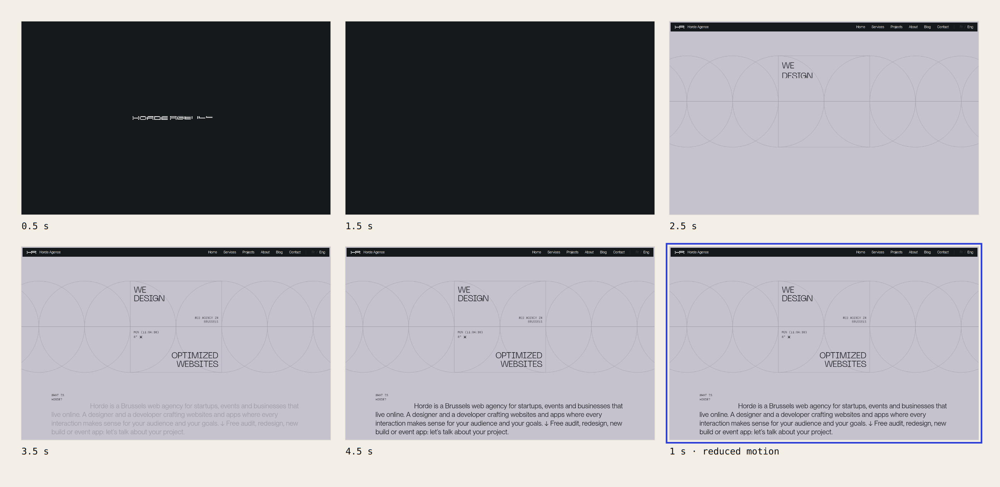
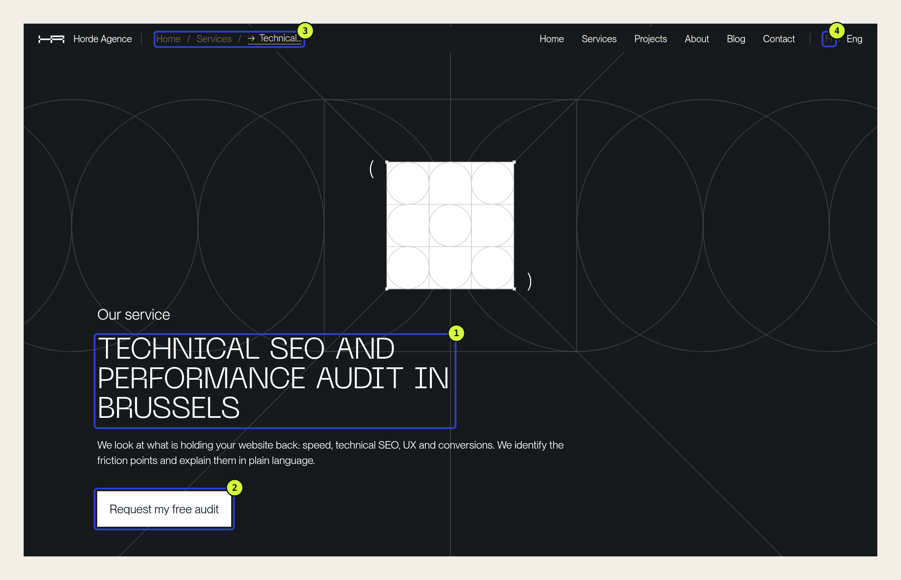
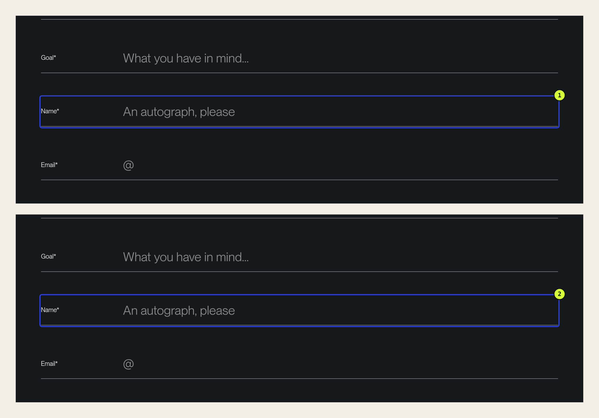

A UI/UX audit answers one question: what stops people from doing what they came to your website to do? The method has four steps. List the key tasks, walk through them on real devices, record each point of friction with evidence, then rank it by how severe it is and how many people it affects.

What you get is not an eighty-item report. It is a short list, in the order things should be fixed. To show how it works, we ran our own website, hordeagence.com, through the method. Flaws included.

## Eighty findings rarely get anything fixed

Most audits fail after delivery, not during. An automated tool, a hundred-point checklist or an expert review will quickly produce a long list. Every line carries the same weight, so a slightly weak contrast sits next to a form nobody can complete.

Faced with that list, a team fixes what is easy rather than what matters. The quick details get done; the rest waits.

Tools also have blind spots. On our site, axe-core, the most widely used accessibility testing engine, flagged a few contrast issues on every page. It missed the most serious problem in our audit, because you only find it by filling in the form with a keyboard. A tool checks rules. It does not do the task the way people do.

## The method in four steps

[Our checklist for judging an interface](/en/blog/what-makes-a-good-web-interface/) covers what to look for: task, hierarchy, comprehension, behavior, access and ownership. The audit method covers the order in which to look, and above all how to sort what you find.

### 1. Start from tasks, not pages

Write down the three or four things people come to your site to do, as verbs. “Understand what you offer”, “book a table”, “ask for a quote”. A page without a clear task is a poor place to start.

### 2. Walk through each task on real devices

Go all the way to the end, including the submit button. Do it on a phone, then on a computer, then with the keyboard alone. Check your analytics too: if most of your visitors arrive on mobile, that is where the audit begins.

### 3. Record each friction point with evidence

A friction point is any moment where someone hesitates, waits, makes a mistake or cannot continue. Record it with whatever proves it: a screenshot, a measurement, a duration, a line of code. “The button is hard to see” is not enough. “The link has a 2:1 contrast ratio and the minimum is 4.5:1” is something you can act on.

### 4. Rank by severity × frequency

This is the step that turns a list into a plan. Each friction point gets two scores from 1 to 3. Back in 1994, Jakob Nielsen suggested [combining how often a problem occurs with its impact](https://www.nngroup.com/articles/how-to-rate-the-severity-of-usability-problems/) to prioritise it. We use a simplified version.

| Score | Severity: what happens? | Frequency: who is affected? |
| --- | --- | --- |
| 3 | Some people cannot finish the task | Almost everyone doing the task |
| 2 | People hesitate, wait or doubt the offer | A clear group: mobile users, first-time visitors, another language |
| 1 | The issue is noticeable but the task gets done | A small group, such as people navigating by keyboard |

The overall score is the product of the two, from 1 to 9. Three rules set the final order:

- **anything with severity 3 goes first**, whatever its frequency: being in a minority is no reason to be locked out;
- then **highest score first**;
- on a tie, **cheapest fix first**.

## Our own site, put through the method

We audited the live version of hordeagence.com on 9 November 2026. We walked through the site in Chromium at 1440 × 900 pixels on desktop and 390 × 844 on mobile, over a fast wired connection. Contrast was measured with axe-core 4.14.0. Traffic figures come from Plausible for the last thirty days: 80 of our 144 visitors arrived on mobile.

We picked three tasks: understand what Horde does, request the free audit, and send the contact form.

### Task 1: understand what Horde does

On the home page, an animation first shows the logo and then builds the headline. That is a brand choice. The audit does not ask whether it looks good. It asks how long it makes people wait.

On a first visit, the full message, “We design optimized websites”, only becomes readable after about 3.5 seconds. The delay comes from the animation, not the network: with the operating system’s reduced motion setting turned on, the same page is readable within a second.

Two things work in our favour. The animation only plays once per visit, and it respects that accessibility setting. Still, roughly a third of our visits start on the home page. For a team that writes about [what a really fast website is](/en/blog/what-is-a-really-fast-website/), 3.5 seconds of perceived waiting is a long time.

### Task 2: request the free audit

Impressions for the audit page in Google have been rising for a month, in both French and English. The content is clear: what we review, how, what you receive, with no commitment. The friction is in the wording.

The same service goes by six names on the English site: “Free SEO, UX and performance audit” on the home page, “Technical SEO audit” in the list of services, “Technical SEO and performance audit” in its page heading (1), “free audit” on its button (2), “Audit (Free)” in the footer, and “Audit (offert)”, still in French, in the contact form.

Each one makes sense on its own. Together, they raise a question nobody should have to ask: is this the same audit? Someone looking for a review of their site’s user experience reads “technical SEO” in large type and may decide it is not for them.

The language switch (4) has a different problem. The inactive language is dark grey on black, with a contrast ratio of 2.03:1. [WCAG 2.2](https://www.w3.org/WAI/WCAG22/Understanding/contrast-minimum.html) requires 4.5:1 for text this size. In Brussels, a share of our visitors are looking for exactly that link.

On mobile, the first screen raises a placement question.

. 1. On the English home page, the first call-to-action button sits at 1,009 px. 2. On the audit page, at 903 px. 3. On the French version, the open menu button reads “Close”, in English. Click to enlarge.")

Neither the home page (1) nor the audit page (2) shows a call-to-action button before you scroll. One swipe is enough, and the audit page places its button right after the introduction. The friction is real but small.

The menu (3) has a translation slip on the French site: once open, its button reads “Close” instead of “Fermer”. The label announced by screen readers is correctly translated.

### Task 3: send the contact form

The contact form is one of the two most visited pages on the site. It gets several things right. The free audit is preselected. After an incomplete submission, each missing field turns red with a “required field” message, and the cursor moves back to the first field to fill in.

The problem shows up with a keyboard.

When you tab into a field, nothing changes on screen. The browser’s focus outline is removed in the code, and the line under the field shifts from one grey (#A29FA9) to an almost identical grey (#9E9AA4). Only the blinking cursor shows where you are typing.

Someone filling in the form by keyboard cannot always tell which field they are in. [WCAG success criterion 2.4.7](https://www.w3.org/WAI/WCAG22/Understanding/focus-visible.html) requires focus to be visible for exactly this reason. The issue only affects the contact page, with its dark background: on the audit page, where the background is light, the line turns black as it should.

## The list the audit produces

Here are the seven friction points we kept, in the order they should be fixed.

| Order | Friction | Task | Severity | Frequency | Score |
| --- | --- | --- | --- | --- | --- |
| 1 | No visible focus in the contact form | Send the form | 3 | 1 | 3, goes first |
| 2 | One audit, six names; the heading does not say “UX” | Request the audit | 2 | 3 | 6 |
| 3 | Home message complete after 3.5 s | Understand the offer | 2 | 3 | 6 |
| 4 | Language link at 2.03:1 | Switch language | 2 | 2 | 4 |
| 5 | No call to action on the first mobile screen | Request the audit | 1 | 3 | 3 |
| 6 | “Close” in the French menu | Navigate on mobile | 1 | 2 | 2 |
| 7 | Breadcrumb at 3.37:1 | Find your way | 1 | 2 | 2 |

The missing focus comes first despite a score of 3, because of the first rule. The two items scoring 6 are separated by effort: renaming the offer means choosing one name and editing a few labels, while the home animation involves a brand decision.

Seven lines, then, not eighty. The audit turned up other details. They stayed off the list because they did not get in the way of any of the three tasks.

## What the score does not decide

The method sets the order. It does not say how to fix things.

For the focus issue, the answer is simple: a visible outline on every field, in the site’s own colours. For the offer’s names, pick one, use it everywhere and put “UX” in the page heading.

The home animation calls for a real trade-off. It could be removed, shortened to under a second, or the message could appear while the logo is still forming. The third option keeps the page’s character and removes the wait. Surfacing that kind of decision is the audit’s job; making it alone is not.

A severity score is also a judgement. We scored the home page wait as 2 because it blocks no one. Another team might score it 1. What matters is writing the reason next to the score, so it can be discussed.

## What this audit does not replace

This audit was carried out by the team that built the site. It does not replace watching people outside the team complete those three tasks, which would almost certainly reveal other friction points.

Nor does it replace a full accessibility audit with a screen reader, or a speed test on a slow mobile network. Our analytics also cover a small sample: 144 visitors in thirty days is enough to see that mobile dominates, not to measure the effect of a fix.

## Audit your own site in an hour

1. Write down your site’s three main tasks, as verbs.
2. Complete each one on your phone, all the way to the end.
3. Do it again with the keyboard alone, using the Tab key.
4. Record every hesitation with a screenshot and one sentence.
5. Give each point a severity and a frequency score from 1 to 3.
6. Sort with the three rules, and keep only what gets in the way of a task.

If you want to know what makes an interface good before auditing it, start with [the six questions for judging one](/en/blog/what-makes-a-good-web-interface/). If the audit shows you need to start over, [a brief built around the experience](/en/blog/web-design-brief-before-screens/) helps you avoid rebuilding the same friction. And to compare your site with ones you admire, we explain [how to learn from an interface without copying it](/en/blog/analyse-web-interface-without-copying/).

**A good audit does not list everything that is wrong; it tells you where to start.** If you would rather have an outside view, our [free audit](/en/services/technical-seo-audit-brussels/) applies this method to your site, with speed and technical SEO included.

## Sources

- hordeagence.com, live version, audited on 9 November 2026 in Chromium 151 at 1440 × 900 and 390 × 844 pixels over a wired connection. Durations were read from screenshots taken every 500 milliseconds and vary by a few hundred milliseconds between runs.
- [axe-core 4.14.0](https://github.com/dequelabs/axe-core), WCAG 2.2 level A and AA rules, for contrast.
- Plausible Analytics for hordeagence.com, 10 October to 9 November 2026: 144 visitors, 80 of them on mobile.
- [Jakob Nielsen, “Severity Ratings for Usability Problems”, Nielsen Norman Group, 1994](https://www.nngroup.com/articles/how-to-rate-the-severity-of-usability-problems/).
- [W3C, WCAG 2.2: Focus Visible, success criterion 2.4.7](https://www.w3.org/WAI/WCAG22/Understanding/focus-visible.html) and [Contrast (Minimum), success criterion 1.4.3](https://www.w3.org/WAI/WCAG22/Understanding/contrast-minimum.html).
