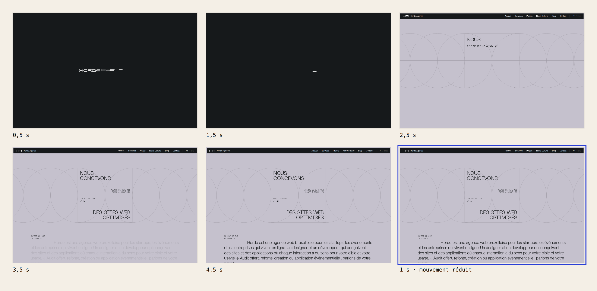
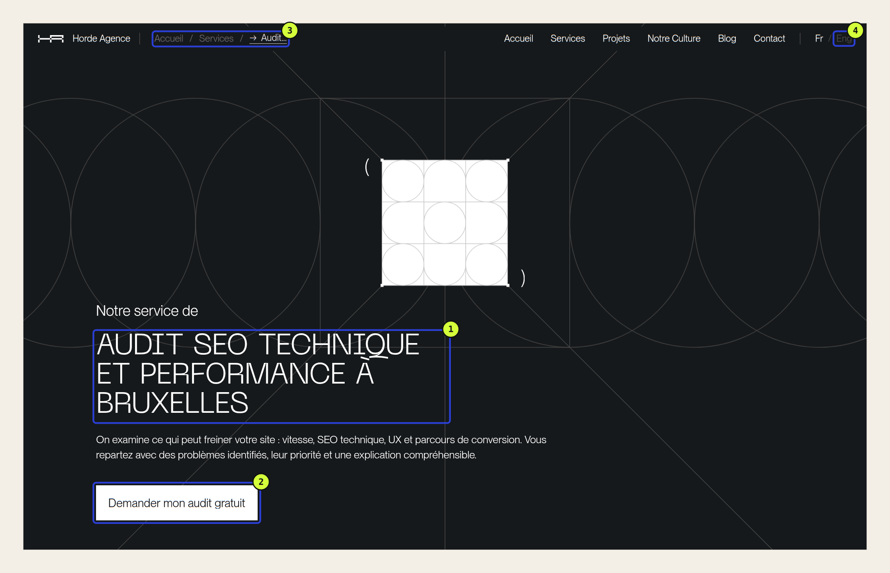
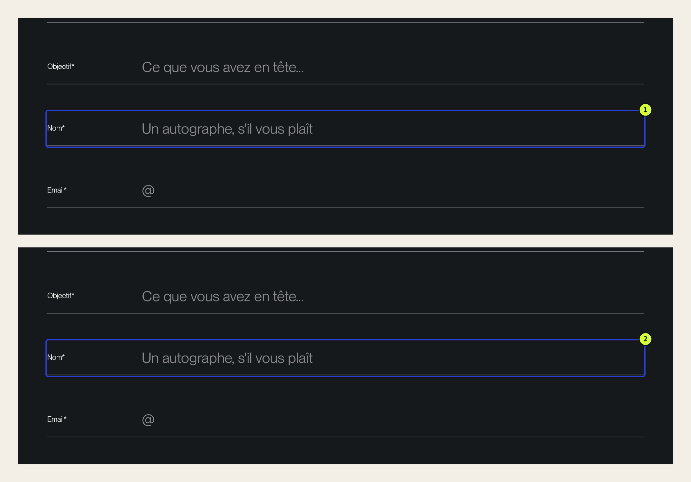

Un audit UX/UI sert à répondre à une question : qu’est-ce qui empêche les gens de faire ce pour quoi ils viennent sur votre site ? La méthode tient en quatre temps. On liste les tâches clés, on les parcourt sur les vrais supports, on note chaque friction avec sa preuve, puis on la classe selon sa gravité et le nombre de personnes qu’elle touche.

Le résultat n’est pas un rapport de quatre-vingts remarques. C’est une liste courte, dans l’ordre où il faut corriger. Pour le montrer, nous avons passé notre propre site, hordeagence.com, à cette grille. Défauts compris.

## Une liste de quatre-vingts remarques ne fait rien corriger

La plupart des audits échouent après la livraison, pas pendant. Un outil automatique, une checklist de cent points ou un regard expert produisent vite une longue liste. Chaque ligne y pèse le même poids : un contraste un peu faible côtoie un formulaire impossible à remplir.

Face à cette liste, une équipe fait ce qui est simple, pas ce qui compte. Elle corrige les détails rapides et repousse le reste.

Les outils ont aussi un angle mort. Sur notre site, axe-core, l’outil d’analyse d’accessibilité le plus répandu, a relevé quelques défauts de contraste sur chaque page. Il n’a pas vu le problème le plus grave de notre audit, parce qu’on ne le trouve qu’en parcourant le formulaire au clavier. Un outil vérifie des règles. Il ne fait pas la tâche à la place des gens.

## La méthode en quatre temps

[Notre grille pour reconnaître une bonne interface](/fr/blog/bonne-interface-web/) dit ce qu’on cherche : la tâche, la hiérarchie, la compréhension, le comportement, l’accès et la responsabilité. La méthode d’audit dit dans quel ordre le chercher, et surtout comment trier ce qu’on trouve.

### 1. Partir des tâches, pas des pages

Écrivez les trois ou quatre choses que les gens viennent faire sur votre site, sous forme de verbes. « Comprendre ce que vous proposez », « réserver une table », « demander un devis ». Une page sans tâche claire n’est pas un bon point de départ.

### 2. Parcourir chaque tâche sur les vrais supports

Faites le parcours en entier, jusqu’à l’envoi. Faites-le sur un téléphone, puis sur un ordinateur, puis au clavier seul. Regardez aussi vos statistiques : si la majorité de vos visiteurs arrive sur mobile, c’est là que l’audit commence.

### 3. Noter une friction avec sa preuve

Une friction, c’est un moment où la personne hésite, attend, se trompe ou ne peut pas continuer. Notez-la avec ce qui la prouve : une capture, une mesure, une durée, un extrait du code. « Le bouton est peu visible » ne suffit pas. « Le lien a un contraste de 2:1, le minimum est de 4,5:1 » permet de décider.

### 4. Classer : gravité × fréquence

C’est l’étape qui transforme la liste en plan. Chaque friction reçoit deux notes, de 1 à 3. Jakob Nielsen proposait déjà en 1994 de [croiser la fréquence et l’impact d’un problème](https://www.nngroup.com/articles/how-to-rate-the-severity-of-usability-problems/) pour le prioriser. Nous en utilisons une version simplifiée.

| Note | Gravité : que se passe-t-il ? | Fréquence : qui est touché ? |
| --- | --- | --- |
| 3 | Certaines personnes ne peuvent pas finir la tâche | Presque toutes les personnes qui font la tâche |
| 2 | La personne hésite, attend ou doute de l’offre | Un groupe net : mobile, première visite, autre langue |
| 1 | La gêne se voit, mais la tâche aboutit | Un groupe restreint, par exemple les personnes qui naviguent au clavier |

Le score est le produit des deux notes, de 1 à 9. Trois règles fixent l’ordre final :

- **un point de gravité 3 passe devant**, quelle que soit sa fréquence : on ne laisse pas une partie du public à la porte parce qu’elle est minoritaire ;
- ensuite, **le score décroissant** ;
- à score égal, **le moins coûteux d’abord**.

## Notre site passé à la grille

Nous avons audité hordeagence.com le 9 novembre 2026, en production. Les parcours ont été faits dans Chromium, à 1440 × 900 pixels sur ordinateur et à 390 × 844 sur mobile, sur une connexion fixe rapide. Les contrastes ont été mesurés avec axe-core 4.14.0. Les statistiques viennent de Plausible, sur les trente derniers jours : 80 des 144 visiteurs sont arrivés sur mobile.

Nous avons retenu trois tâches : comprendre ce que fait Horde, demander l’audit offert, envoyer le formulaire de contact.

### Tâche 1 : comprendre ce que fait Horde

Sur la page d’accueil, une animation présente d’abord le logo, puis compose le titre. C’est un choix de marque. La question de l’audit n’est pas de savoir s’il est beau, mais combien de temps il fait attendre.

Lors d’une première visite, le message complet, « Nous concevons des sites web optimisés », n’est lisible qu’au bout de 3,5 secondes environ. Ce délai vient de l’animation, pas du réseau : avec le réglage « mouvement réduit » du système, la même page est lisible en une seconde.

Deux points jouent en notre faveur. L’animation ne se rejoue pas pendant la visite, et elle respecte ce réglage d’accessibilité. Il reste qu’environ un tiers de nos visites commence sur cette page. Sur un [site qu’on veut vraiment rapide](/fr/blog/c-est-quoi-un-site-vraiment-rapide/), 3,5 secondes d’attente perçue, c’est long.

### Tâche 2 : demander l’audit offert

Les impressions de la page de l’audit dans Google sont en hausse depuis un mois, en français comme en anglais. La page est claire sur le fond : ce qu’on examine, comment, ce que vous recevez, sans engagement. La friction se trouve dans les mots.

Le même service porte cinq noms sur le site : « Audit SEO, UX et performance offert » sur l’accueil, « Audit SEO technique » dans la liste des services, « Audit SEO technique et performance » dans le titre de sa page (1), « audit gratuit » sur son bouton (2) et « Audit (offert) » dans le pied de page et le formulaire.

Pris un par un, chacun se comprend. Ensemble, ils posent une question que personne ne devrait avoir à se poser : est-ce le même audit ? Une personne qui cherche un regard sur l’expérience de son site lit « SEO technique » en grand et peut conclure que ce n’est pas pour elle.

Le lien vers la version anglaise (4) pose un autre problème. Il est gris foncé sur fond noir, avec un contraste de 2,03:1. Les règles [WCAG 2.2](https://www.w3.org/WAI/WCAG22/Understanding/contrast-minimum.html) demandent 4,5:1 pour un texte de cette taille. À Bruxelles, une partie de nos visiteurs cherche précisément ce lien.

Sur mobile, le premier écran pose une question de placement.

. 1. Sur l’accueil, le premier bouton d’action se trouve à 1 070 px. 2. Sur la page de l’audit, à 965 px. 3. Dans la version française, le bouton du menu ouvert affiche « Close ». Cliquez pour agrandir.")

Sur l’accueil (1) comme sur la page de l’audit (2), aucun bouton d’action n’apparaît avant de faire défiler. Il suffit d’un geste du pouce, et la page de l’audit place son bouton juste après le paragraphe d’introduction. La gêne est réelle mais légère.

Le menu (3) contient un oubli de traduction : une fois ouvert, son bouton affiche « Close » sur la version française. L’intitulé lu par les lecteurs d’écran, lui, est bien traduit.

### Tâche 3 : envoyer le formulaire de contact

Le formulaire de contact est l’une des deux pages les plus visitées du site. Il fait plusieurs choses bien. L’audit offert est présélectionné. Après un envoi incomplet, chaque champ manquant passe en rouge avec la mention « Champ obligatoire », et le curseur revient au premier champ à remplir.

Le problème apparaît au clavier.

Quand on arrive dans un champ avec la touche Tab, rien ne change à l’écran. Le contour du navigateur est supprimé dans le code, et la ligne sous le champ passe d’un gris (#A29FA9) à un autre gris presque identique (#9E9AA4). Seul le curseur clignotant indique où l’on tape.

Une personne qui remplit le formulaire au clavier ne sait donc pas toujours quel champ elle est en train de compléter. Le critère [WCAG 2.4.7](https://www.w3.org/WAI/WCAG22/Understanding/focus-visible.html) demande justement que le focus soit visible. Le défaut ne concerne que la page de contact, sur fond sombre : sur la page de l’audit, où le fond est clair, la ligne passe bien au noir.

## Le tableau qui sort de l’audit

Voici les sept frictions retenues, dans l’ordre de correction.

| Ordre | Friction | Tâche | Gravité | Fréquence | Score |
| --- | --- | --- | --- | --- | --- |
| 1 | Focus invisible dans le formulaire de contact | Envoyer le formulaire | 3 | 1 | 3, passe devant |
| 2 | Le même audit porte cinq noms, le titre ne dit pas « UX » | Demander l’audit | 2 | 3 | 6 |
| 3 | Message d’accueil complet après 3,5 s | Comprendre l’offre | 2 | 3 | 6 |
| 4 | Lien « Eng » à 2,03:1 | Changer de langue | 2 | 2 | 4 |
| 5 | Aucun bouton d’action dans le premier écran mobile | Demander l’audit | 1 | 3 | 3 |
| 6 | « Close » dans le menu français | Naviguer sur mobile | 1 | 2 | 2 |
| 7 | Fil d’Ariane à 3,37:1 | Se repérer | 1 | 2 | 2 |

Le focus invisible arrive en tête malgré son score de 3, en vertu de la première règle. Les deux points à 6 sont départagés par l’effort : renommer l’offre demande de choisir un nom et de modifier quelques textes, alors que l’animation d’accueil engage un choix de marque.

Sept lignes, donc, et pas quatre-vingts. L’audit a relevé d’autres détails. Ils sont restés hors de la liste parce qu’ils ne gênaient aucune des trois tâches.

## Ce que le score ne décide pas

La grille ordonne. Elle ne dit pas comment corriger.

Pour le focus, la réponse est simple : un contour visible sur chaque champ, dans la couleur du site. Pour les noms de l’offre, il faut en choisir un, l’utiliser partout et faire figurer « UX » dans le titre de la page.

L’animation d’accueil demande un vrai arbitrage. On peut la supprimer, la raccourcir sous la seconde, ou afficher le message pendant que le logo se compose. La troisième option garde le caractère de la page et supprime l’attente. C’est ce genre de décision que l’audit doit rendre visible, pas trancher seul.

Une note de gravité reste aussi un jugement. Nous avons noté 2 l’attente de l’accueil, parce qu’elle ne bloque personne. Une autre équipe pourrait la noter 1. Ce qui compte, c’est d’écrire la raison à côté de la note, pour pouvoir en discuter.

## Ce que cet audit ne remplace pas

Cet audit a été fait par l’équipe qui a conçu le site. Il ne remplace pas l’observation de personnes extérieures en train de réaliser ces trois tâches, qui ferait sûrement apparaître d’autres frictions.

Il ne remplace pas non plus un audit d’accessibilité complet, avec lecteur d’écran, ni une mesure de vitesse sur un réseau mobile lent. Nos statistiques portent enfin sur un petit volume : 144 visiteurs en trente jours suffisent à voir que le mobile domine, pas à mesurer l’effet d’une correction.

## Faire l’audit de votre site en une heure

1. Écrivez les trois tâches principales de votre site, sous forme de verbes.
2. Faites chacune sur votre téléphone, jusqu’à l’envoi.
3. Refaites-la au clavier seul, avec la touche Tab.
4. Notez chaque hésitation avec une capture et une phrase.
5. Donnez à chaque point une gravité et une fréquence, de 1 à 3.
6. Triez avec les trois règles, et ne gardez que ce qui gêne une tâche.

Si vous voulez savoir ce que vaut une interface avant de l’auditer, commencez par [les six questions pour la juger](/fr/blog/bonne-interface-web/). Si l’audit montre qu’il faut repartir de zéro, [un brief centré sur l’expérience](/fr/blog/brief-design-web-cadrer-experience/) évite de reproduire les mêmes frictions. Pour comparer votre site à ceux que vous admirez, nous expliquons aussi [comment s’inspirer d’une interface sans la copier](/fr/blog/analyser-interface-web-sans-copier/).

**Un bon audit ne dit pas tout ce qui ne va pas ; il dit par quoi commencer.** Si vous préférez un regard extérieur, notre [audit offert](/fr/services/audit-seo-technique-bruxelles/) applique cette méthode à votre site, avec la vitesse et le SEO technique en plus.

## Sources

- hordeagence.com, version de production, auditée le 9 novembre 2026 dans Chromium 151 à 1440 × 900 et 390 × 844 pixels, sur connexion fixe. Durées relevées sur des captures successives toutes les 500 millisecondes ; elles varient de quelques centaines de millisecondes d’un essai à l’autre.
- [axe-core 4.14.0](https://github.com/dequelabs/axe-core), règles WCAG 2.2 niveaux A et AA, pour les contrastes.
- Plausible Analytics de hordeagence.com, du 10 octobre au 9 novembre 2026 : 144 visiteurs, dont 80 sur mobile.
- [Jakob Nielsen, « Severity Ratings for Usability Problems », Nielsen Norman Group, 1994](https://www.nngroup.com/articles/how-to-rate-the-severity-of-usability-problems/).
- [W3C, WCAG 2.2 : Focus Visible, critère 2.4.7](https://www.w3.org/WAI/WCAG22/Understanding/focus-visible.html) et [Contrast (Minimum), critère 1.4.3](https://www.w3.org/WAI/WCAG22/Understanding/contrast-minimum.html).
