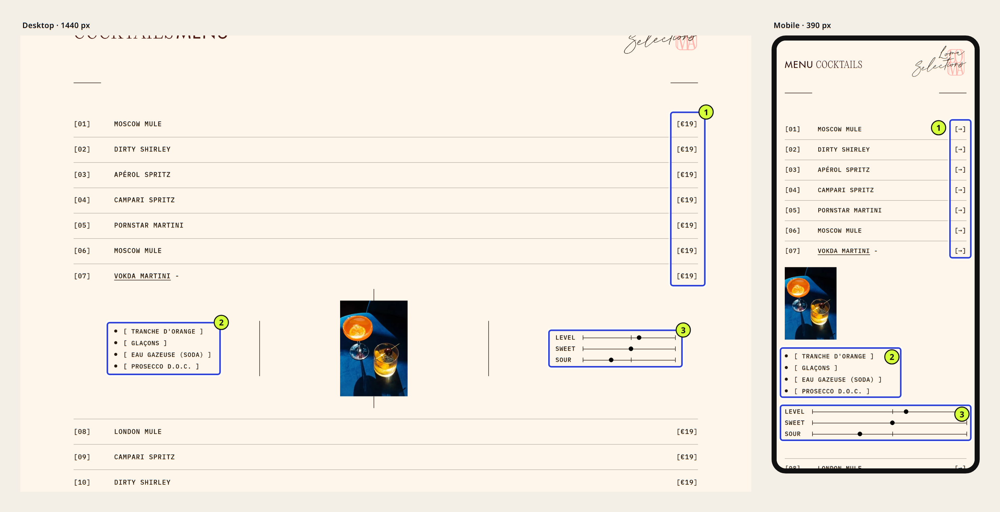
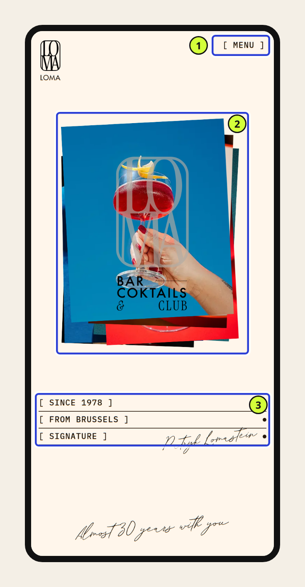

You can tell a good web interface by what it lets people do, not by how good it looks in a screenshot. It puts what visitors came for first and uses words they understand without effort. It responds predictably, and it still works on a phone, with a keyboard or with tired eyes. And someone knows who will keep it up to date.

Six questions are enough to check: task, hierarchy, comprehension, behavior, access and ownership. You do not need to be a designer to ask them. Below, we apply them to a landing page we are building right now, including what they reveal and what they cannot tell us yet.

## A great screenshot does not make a good interface

A screenshot shows a frozen state, usually the most flattering one: the first screen, on a large monitor, with perfect content. It shows no loading, no error message, no thumb missing an undersized button on a moving bus.

That does not make aesthetics secondary. Strong art direction is part of what makes an interface memorable, and enjoying a product matters. The trouble starts when the visual impression becomes the verdict. “It looks great” answers a different question from “people find what they need.”

A good interface does both. You recognise it precisely because its character costs the person using it nothing.

## Six questions to judge an interface

We use this checklist to review our own screens, and first described it in [our piece on AI and user experience](/en/blog/ai-can-create-interfaces-not-experiences/). Here it is rephrased for anyone who has to judge a website, whether it is their own or one being delivered to them.

| Criterion | The question to ask | What you can check yourself |
| --- | --- | --- |
| Task | Why does someone come to this page? | Write one sentence on what visitors must be able to do or learn |
| Hierarchy | Is what serves that task what you notice first? | Squint at the screen: what stands out? |
| Comprehension | Are the words and information enough on their own? | Ask an outsider to read the page and note their questions |
| Behavior | What happens after a click, an entry or a mistake? | Complete the whole journey, including getting things wrong |
| Access | Can the task be done on mobile, by keyboard, with weaker eyesight? | Test on a real phone, then using only the Tab key |
| Ownership | Who updates the page and decides what happens next? | Name the person who will edit the next piece of content |

The first four questions can be answered in front of the screen. The last two force you beyond the mockup: they are about real use and about the site’s life after launch.

## The checklist applied to a landing page in progress

To show what the checklist produces, we applied it to a Horde project currently in development: the landing page for Loma, a cocktail bar in Brussels. The site is not live yet. We reviewed its development build on November 7, 2026, in Chromium, at 1440 and 390 pixels wide.

So this is not a showcase of finished work. It is a mid-project review: what it confirms, what it brings to light and what it cannot settle yet.

### Task: get a feel for the place, then go there

On a bar’s website, visitors usually want two things: to sense the atmosphere and to know whether they can drop by tonight. The atmosphere comes across instantly. The second half of the task has no place on the page yet.

, development build captured on November 7, 2026. 1. The photo collage sets the mood. 2. The wordmark names the venue and what it is. 3. The navigation offers Home, Menu and Events. Click to enlarge.")

The collage of tilted photos (1) gives the venue an identity straight away: bold colours, close-up glasses, a hand holding out a cocktail. The wordmark (2) says what the place is. Within a second, you know it is a cocktail bar rather than just any bar.

The navigation (3) promises three destinations. The page, however, gives no address, opening hours or way to book. That is the first decision to make: is the landing page for people discovering Loma, or for regulars checking the menu? The answer changes what must appear before the first scroll.

### Hierarchy and comprehension: a menu caught between style and reading

The cocktail menu is the heart of the page. It is a numbered list, and each row expands to show a photo, the ingredients and three scales.

On desktop, the structure reads very easily. Number, name, price: you scan the column like a chalkboard menu, and the price (1) sits exactly where the eye expects it.

On mobile, the same column shows an arrow instead of the price. Visually, it is calmer. For the task, it is a loss: price is part of what people look for on a menu. This is a textbook gap between “beautiful” and “good”, and you only see it by comparing the two formats side by side.

The scales (3) are a good idea: they sum up a flavour without jargon. “Sweet” and “Sour” are self-explanatory, but “Level” is ambiguous. Alcohol strength? Intensity? A scale people have to decode no longer saves them time.

### Behavior: what a screenshot cannot show

A menu row opens and closes, a featured cocktail expands with “+INFO”, and a form invites visitors to join the newsletter. A screenshot captures none of these moments.

You have to go through them. What do you see while a row opens? Can you close it easily? What happens after signing up, or after a mistyped email address? We have not checked this systematically yet. It is on the list.

### Access: thumbs, small type and the keyboard

On a phone, the first screen keeps its character: the collage becomes a stack of photos, and the handwritten signature stays.

The “Menu” button (1) measures 69 × 18 pixels. [WCAG 2.2](https://www.w3.org/WAI/WCAG22/Understanding/target-size-minimum.html) asks for targets of at least 24 pixels unless there is enough space around them, which is the case here. So the guideline is met. Still, an 18-pixel-high target is small for a thumb, especially in a dimly lit bar.

Ingredients and scales are set at 11 pixels in a monospaced typeface. That fits the visual identity and reads fine in good conditions. Will it still work for someone who left their glasses at home, or on a sunny terrace? Only testing with real people will tell.

Keyboard navigation and screen readers have not been checked yet. Every image has alternative text, which is a good starting point, not proof of accessibility.

### Ownership: who will change the menu in March?

A bar menu changes: new cocktails, revised prices, special nights. Even the most carefully designed page decays if every edit means calling the agency.

The question to settle with the client is not technical. Who edits the menu, with what tool, and who checks the mobile version still holds up after each change? Until that has an answer, the interface is not finished.

## What the review brought to light

| Criterion | What we observe | What remains to decide or test |
| --- | --- | --- |
| Task | The atmosphere is clear from the first screen | Address, hours, booking: where, and for whom? |
| Hierarchy | Menu reads very well on desktop | Should the price stay visible on mobile? |
| Comprehension | Scales help describe flavour | What “Level” means |
| Behavior | Expandable rows, newsletter form | Opening, closing and input errors to walk through |
| Access | Alternative text present | Touch targets, 11 px text, keyboard, screen reader |
| Ownership | — | Who updates the menu, and how |

None of these rows says the landing page succeeds or fails. They turn an impression into a list of decisions, which is precisely what moves a project forward.

## Where “beautiful” and “good” part ways

In this example, the gaps share a pattern: a visual choice that serves the identity makes a piece of information a little harder to reach. The arrow instead of the price and the small monospaced type: each one can be defended.

The answer is not to strip out the character and fall back on a neutral template. It is to find the version that keeps the style and still delivers the information. For instance, a price set in the same typeface as the arrow, or a scale renamed with a word everyone understands. That is what [art direction for an interface](/en/blog/art-direction-for-web-interfaces/) is for: adding character without blurring priorities.

## What the checklist does not replace

The checklist organises how you look at a page. It is not a full accessibility audit, a performance measurement on the production build, or a substitute for watching real people use the site.

For Loma, the next steps are concrete. Test the menu on phones with a few of the bar’s customers, measure loading once the site is in production, and work through the page by keyboard. The development build is not a reliable basis for speed measurements: it is deliberately heavier than a published site.

The same checklist also works for judging a site that is not yours, such as a reference you admire or an agency’s proposal. We explain how in [our guide to using a website as inspiration without copying it](/en/blog/analyse-web-interface-without-copying/).

## Where to start with your own site

Take your most important page and write one sentence about what visitors come there to do. Then open it on your phone and complete the journey to the end, assuming nothing. The six questions will do the rest.

**A good interface needs no instruction manual; it needs to have been reviewed with the right questions.** If you would like an outside view of your site, our [free audit](/en/services/technical-seo-audit-brussels/) covers user experience and journeys as well as speed and technical SEO. And if the answer is to start again, we also design [landing pages](/en/services/landing-page-design-brussels/) and [complete redesigns](/en/services/website-redesign-brussels/).

## Sources

- Loma landing page, a Horde project in development, reviewed and captured on November 7, 2026 on the development build (unpublished, not indexed), in Chromium at 1440 × 900 and 390 × 844 pixels. Text and target sizes were measured in the browser. Some displayed content is provisional.
- [W3C, WCAG 2.2: Understanding Success Criterion 2.5.8, Target Size (Minimum)](https://www.w3.org/WAI/WCAG22/Understanding/target-size-minimum.html).
