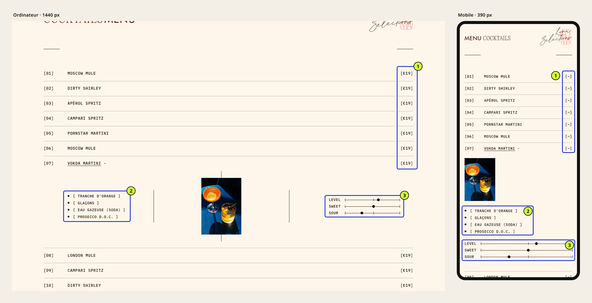
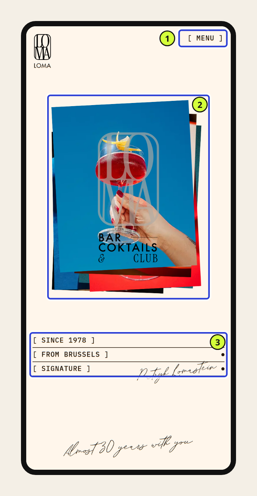

Une bonne interface web se reconnaît à ce qu’elle permet de faire, pas à l’effet produit par une capture d’écran. Elle montre d’abord ce que la personne est venue chercher et utilise des mots qu’elle comprend sans effort. Elle réagit de façon prévisible et reste utilisable sur un téléphone, au clavier ou avec une vue fatiguée. Enfin, quelqu’un sait qui la fait évoluer.

Six questions suffisent pour le vérifier : la tâche, la hiérarchie, la compréhension, le comportement, l’accès et la responsabilité. Vous pouvez les poser vous-même, sans être designer. Nous les appliquons ci-dessous à une landing page que nous sommes en train de fabriquer, avec ce qu’elles révèlent et ce qu’elles ne disent pas encore.

## Une belle capture ne dit pas si l’interface est bonne

Une capture montre un état figé, souvent le plus flatteur : le premier écran, sur un grand moniteur, avec des contenus parfaits. Elle ne montre ni l’attente, ni l’erreur, ni le pouce qui rate un bouton trop petit dans un bus.

Cela ne signifie pas que l’esthétique est secondaire. Une direction artistique forte fait partie de ce qui rend une interface mémorable, et le plaisir d’utilisation compte. Le problème apparaît lorsque l’impression visuelle sert de verdict. « C’est beau » répond à une autre question que « on trouve ce qu’on cherche ».

Une bonne interface tient les deux. On la reconnaît justement parce que son caractère ne coûte rien à la personne qui l’utilise.

## Six questions pour juger une interface

Nous utilisons cette grille pour relire nos propres écrans, et nous l’avions présentée dans [notre article sur l’IA et l’expérience utilisateur](/fr/blog/ia-interfaces-experiences-utilisateur/). La voici reformulée pour quelqu’un qui doit juger un site, le sien ou celui qu’on lui livre.

| Critère | La question à poser | Ce que vous pouvez vérifier vous-même |
| --- | --- | --- |
| Tâche | Pourquoi vient-on sur cette page ? | Écrire en une phrase ce que le visiteur doit pouvoir faire ou savoir |
| Hiérarchie | Ce qui sert cette tâche est-il ce qu’on voit en premier ? | Plisser les yeux devant l’écran : qu’est-ce qui ressort ? |
| Compréhension | Les mots et les informations suffisent-ils, sans explication ? | Faire lire la page à quelqu’un d’extérieur et noter ses questions |
| Comportement | Que se passe-t-il après un clic, une saisie ou une erreur ? | Faire le parcours en entier, y compris en se trompant |
| Accès | La tâche reste-t-elle possible sur mobile, au clavier, avec une petite vue ? | Tester sur un vrai téléphone, puis avec la seule touche Tab |
| Responsabilité | Qui met à jour la page et qui décide de la suite ? | Nommer la personne qui modifiera le prochain contenu |

Les quatre premières questions se posent devant l’écran. Les deux dernières obligent à sortir de la maquette : elles concernent l’usage réel et la vie du site après sa livraison.

## La grille appliquée à une landing page en cours

Pour montrer ce que la grille produit, nous l’appliquons à un projet Horde en cours : la landing page de Loma, un bar à cocktails bruxellois. Le site n’est pas en ligne. Nous l’avons observé le 7 novembre 2026 sur sa version de développement, dans Chromium, à 1440 et à 390 pixels de large.

Ce n’est donc pas une vitrine d’un résultat fini. C’est une relecture de mi-parcours, avec ce qu’elle confirme, ce qu’elle fait apparaître et ce qu’elle ne peut pas encore trancher.

### Tâche : savoir à quoi ressemble le lieu, puis y venir

Pour un bar, le visiteur veut généralement deux choses : sentir l’ambiance et savoir s’il peut venir ce soir. L’ambiance est servie immédiatement. La seconde moitié de la tâche n’a pas encore de place sur la page.

, version de développement capturée le 7 novembre 2026. 1. Le collage de photos installe l’univers. 2. Le logotype nomme le lieu et sa catégorie. 3. La navigation propose Accueil, Menu et Events. Cliquez pour agrandir.")

Le collage de photos inclinées (1) donne tout de suite une identité au lieu : couleurs franches, verres en gros plan, une main qui tend un cocktail. Le logotype (2) dit ce que c’est. On comprend en une seconde qu’il s’agit d’un bar à cocktails, et pas d’un bar générique.

La navigation (3) annonce trois destinations. La page ne donne en revanche ni adresse, ni horaires, ni moyen de réserver. C’est la première décision à prendre : la landing sert-elle les personnes qui découvrent Loma, ou celles qui le connaissent déjà et viennent vérifier la carte ? La réponse change ce qui doit figurer avant le premier défilement.

### Hiérarchie et compréhension : la carte, entre style et lecture

La carte des cocktails est le cœur de la page. Elle est présentée comme une liste numérotée, dont chaque ligne se déplie pour montrer une photo, les ingrédients et trois jauges.

Sur ordinateur, la structure est très lisible. Numéro, nom, prix : on parcourt la colonne comme une ardoise, et le prix (1) est aligné là où l’œil l’attend.

Sur mobile, la même colonne affiche une flèche à la place du prix. Visuellement, c’est plus calme. Pour la tâche, c’est une perte : le prix fait partie de ce qu’on vient chercher sur une carte. Voilà un écart typique entre « beau » et « bon », et il ne se voit qu’en comparant les deux formats.

Les jauges (3) sont une bonne idée : elles résument un goût sans jargon. Mais « Sweet » et « Sour » se comprennent, alors que « Level » reste ambigu. Est-ce la force en alcool ? L’intensité ? Une jauge que l’on doit interpréter ne fait plus gagner de temps.

### Comportement : ce que la capture ne montre pas

Une ligne de la carte s’ouvre et se referme, une sélection de cocktails se déplie avec « +INFO », un formulaire propose l’inscription à la newsletter. Une capture ne dit rien de ces moments.

Il faut les parcourir : que voit-on pendant l’ouverture, peut-on refermer facilement, que se passe-t-il après l’inscription, et si l’adresse e-mail est mal saisie ? À ce stade, nous ne l’avons pas encore vérifié de façon systématique. C’est sur la liste.

### Accès : le pouce, la petite police et le clavier

Sur téléphone, le premier écran garde son caractère : le collage devient une pile de photos, et la signature manuscrite reste présente.

Le bouton « Menu » (1) mesure 69 × 18 pixels. Les règles d’accessibilité [WCAG 2.2](https://www.w3.org/WAI/WCAG22/Understanding/target-size-minimum.html) demandent une cible d’au moins 24 pixels, sauf si l’espace autour suffit, ce qui est le cas ici. La règle est donc respectée. Mais une cible de 18 pixels de haut reste petite pour un pouce, surtout dans un bar faiblement éclairé.

Les ingrédients et les jauges sont composés en 11 pixels, dans une police à chasse fixe. C’est cohérent avec l’univers, et lisible dans de bonnes conditions. Est-ce encore lisible pour quelqu’un qui a oublié ses lunettes, ou un soir de terrasse en plein soleil ? Il faudra le tester avec de vraies personnes.

Le clavier et les lecteurs d’écran n’ont pas encore été vérifiés. Toutes les images ont un texte alternatif, ce qui est un bon point de départ, pas une preuve d’accessibilité.

### Responsabilité : qui changera la carte en mars ?

Une carte de bar change : nouveaux cocktails, prix revus, soirées spéciales. La page la plus soignée se dégrade si chaque modification demande d’appeler l’agence.

La question à régler avec le client n’est pas technique : qui modifie la carte, avec quel outil, et qui vérifie que la version mobile reste juste après chaque changement ? Tant qu’elle n’a pas de réponse, l’interface n’est pas terminée.

## Ce que la relecture a fait apparaître

| Critère | Ce qu’on observe | Ce qui reste à décider ou à tester |
| --- | --- | --- |
| Tâche | L’ambiance est claire dès le premier écran | Adresse, horaires, réservation : où et pour qui ? |
| Hiérarchie | Carte très lisible sur ordinateur | Le prix doit-il rester visible sur mobile ? |
| Compréhension | Jauges utiles pour le goût | Le sens de « Level » |
| Comportement | Lignes dépliables, newsletter | Ouverture, fermeture, erreurs de saisie à parcourir |
| Accès | Textes alternatifs présents | Cibles tactiles, textes en 11 px, clavier, lecteur d’écran |
| Responsabilité | — | Qui met à jour la carte et comment |

Aucune de ces lignes ne dit que la landing est réussie ou ratée. Elles transforment une impression en liste de décisions, et c’est précisément ce qui permet d’avancer.

## Où « beau » et « bon » se séparent

Dans cet exemple, les écarts ont un point commun : un choix visuel juste pour l’identité qui rend une information un peu plus difficile d’accès. La flèche à la place du prix, la petite police à chasse fixe : chacun peut se défendre.

La bonne réponse n’est pas d’effacer le caractère pour revenir à un modèle neutre. Elle consiste à chercher la version qui garde le style et rend l’information. Par exemple, un prix composé dans la même police que la flèche, ou une jauge renommée avec un mot que tout le monde comprend. C’est le travail de la [direction artistique d’une interface](/fr/blog/direction-artistique-interface-web/) : donner du caractère sans brouiller les priorités.

## Ce que la grille ne remplace pas

La grille organise un regard. Elle ne remplace ni un audit d’accessibilité complet, ni la mesure des performances sur la version de production, ni l’observation de vraies personnes en train d’utiliser le site.

Pour Loma, les prochaines étapes sont concrètes. Tester la carte sur téléphone avec quelques clients du bar, mesurer le chargement une fois le site en production et parcourir la page au clavier. La version de développement ne se prête pas à une mesure de vitesse fiable : elle est volontairement plus lourde qu’un site publié.

La même grille sert aussi à juger un site qui n’est pas le vôtre : une référence que vous aimez, ou la proposition d’un prestataire. Nous l’expliquons dans [notre méthode pour s’inspirer d’un site sans le copier](/fr/blog/analyser-interface-web-sans-copier/).

## Par où commencer avec votre propre site

Prenez votre page la plus importante et écrivez en une phrase ce que le visiteur vient y faire. Ouvrez-la ensuite sur votre téléphone et faites le parcours jusqu’au bout, sans rien supposer. Les six questions feront le reste.

**Une bonne interface ne demande pas de mode d’emploi ; elle demande d’avoir été relue avec les bonnes questions.** Si vous voulez un regard extérieur sur votre site, notre [audit offert](/fr/services/audit-seo-technique-bruxelles/) couvre l’expérience et le parcours, en plus de la vitesse et du SEO technique. Et si la réponse est qu’il faut repartir de zéro, nous concevons aussi des [landing pages](/fr/services/creation-landing-page/) et des [refontes complètes](/fr/services/refonte-site-web-bruxelles/).

## Sources

- Landing page de Loma, projet Horde en cours de développement, observée et capturée le 7 novembre 2026 sur la version de développement (non publiée, non indexée), dans Chromium à 1440 × 900 et 390 × 844 pixels. Les tailles de texte et de cibles sont mesurées dans le navigateur. Les contenus affichés sont en partie provisoires.
- [W3C, WCAG 2.2 : Target Size (Minimum), critère 2.5.8](https://www.w3.org/WAI/WCAG22/Understanding/target-size-minimum.html).
